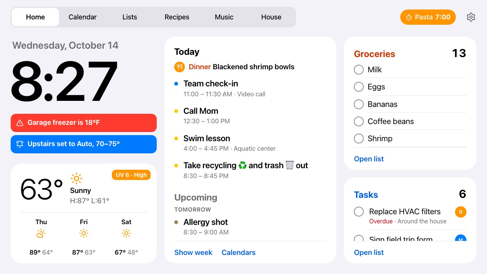
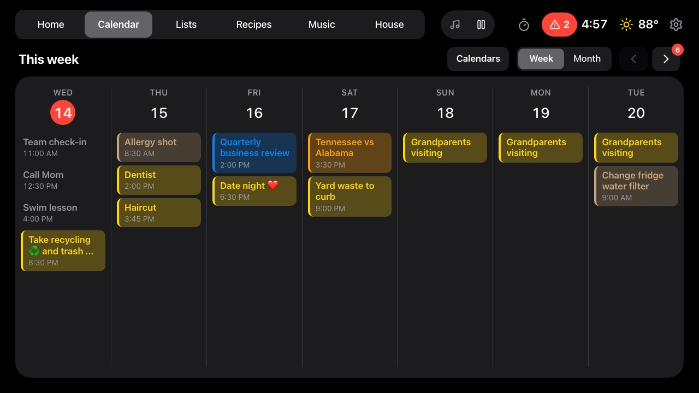
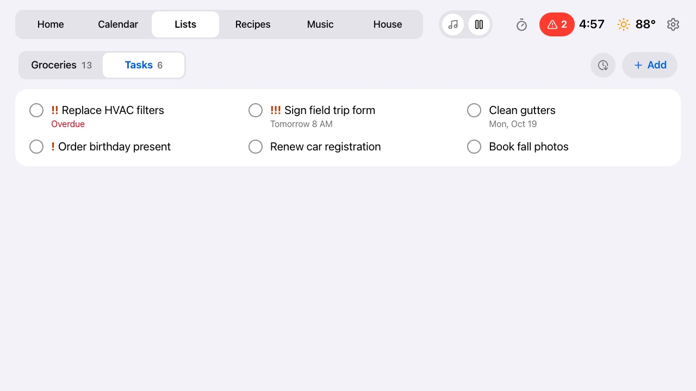
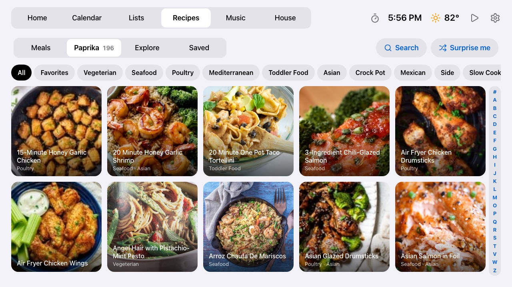
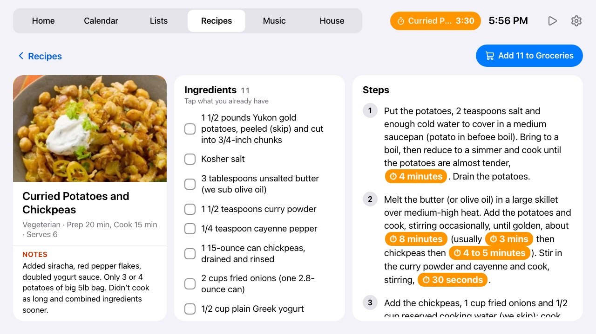
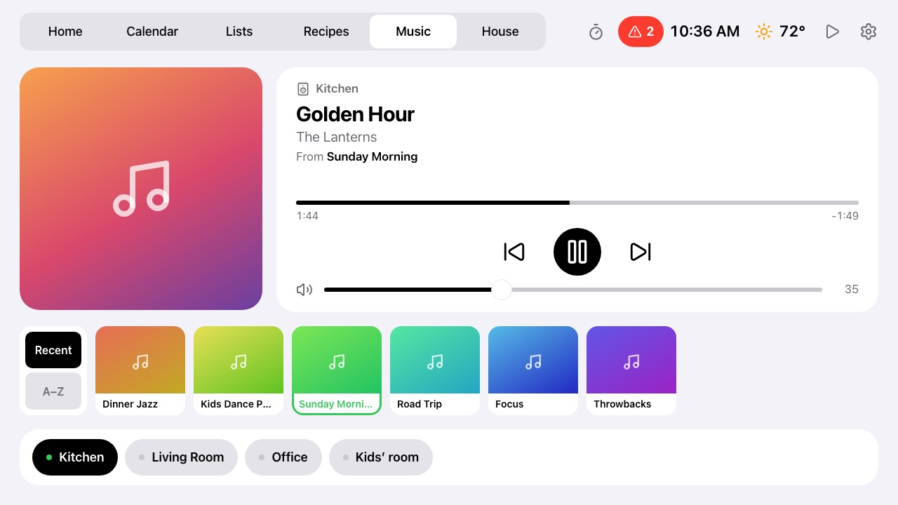
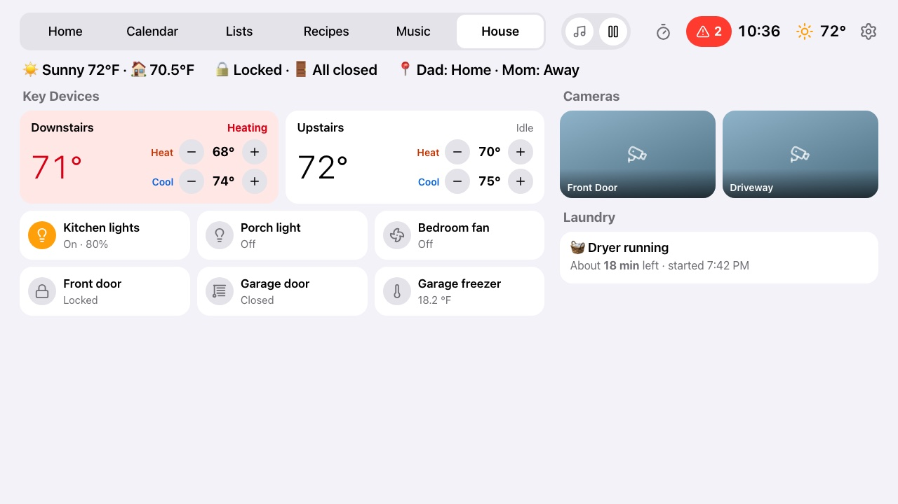
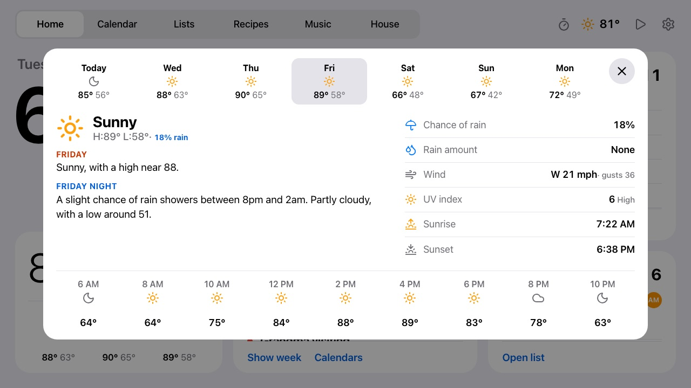
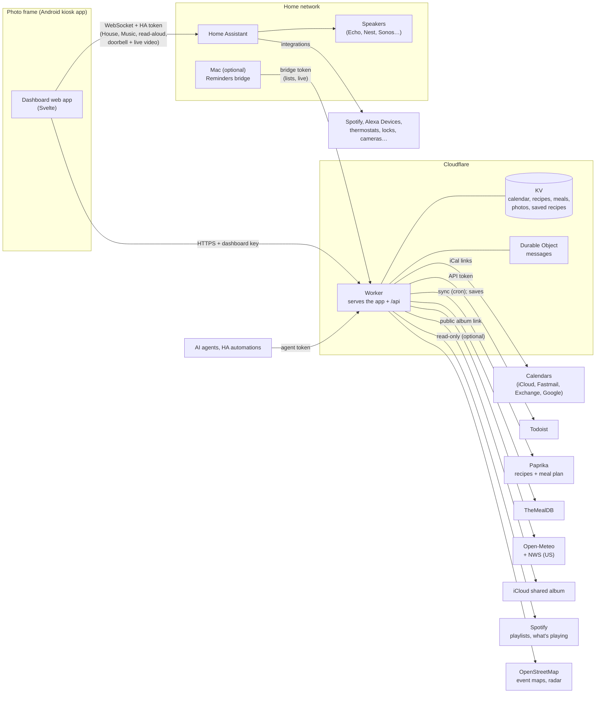

# Photo Frame Dashboard

A calm family dashboard for a cheap Android photo frame on the kitchen wall: clock, weather, the
family calendar, [Todoist](https://www.todoist.com) tasks and groceries,
[Paprika](https://www.paprikaapp.com) recipes and meal plans, music,
[Home Assistant](https://www.home-assistant.io) devices, a doorbell camera pop-up, messages from AI agents, and a photo
slideshow when nobody's looking. It runs on a $50–100-ish Android photo frame and a
[Cloudflare Worker](https://workers.cloudflare.com) (free plan).

The frame this fork uses is the **Pastigio 15.6" Frameo** (board `FRAME156`, 1920×1080, Android
8.1). It's sold in several finishes; check the screen size, as the same name also covers 10.1"
models. Wes's [device table](https://github.com/wesbos/photo-frame-dashboard/blob/main/docs/devices.md)
lists other frames that work.



| Calendar (dark, after sunset) | Lists | Recipes |
| --- | --- | --- |
|  |  |  |

| Recipe with timers in its directions | Media (music) | House |
| --- | --- | --- |
|  |  |  |

| Weather details (tap the weather) |
| --- |
|  |

Screenshots use the built-in demo mode (Settings → About → Demo mode, or `?demo=on`), so all data shown is
invented, apart from the weather. It's also handy for showing the frame to people without your own
calendar and lists on it. `?tab=`, `?open=<recipe id>`, `?explore=<category>`, `?timer=Pasta:7`,
`?weather=<day>` and `?settings=<tab>` set up a particular screen.

## Thanks

This is a fork, and it stands on two people's work:

- **[Wes Bos](https://github.com/wesbos)** had the idea and showed it works: his video
  [Taking over Android photo frames](https://youtu.be/ZLycoUMltNI) and his repository
  [wesbos/photo-frame-dashboard](https://github.com/wesbos/photo-frame-dashboard), with the device
  guides for unlocking many frame models.
- **[Hunter Yeagley](https://github.com/huntsyea)** built
  [huntsyea/kitchen-frame](https://github.com/huntsyea/kitchen-frame), which this repository is
  forked from: the Svelte dashboard, the Cloudflare Worker (calendar, weather, Todoist, photos,
  recipes, agent messages), the Music tab, the kiosk app and the frame setup notes.

Go watch the video and star both repositories. See [CREDITS.md](CREDITS.md) for the rest.

## What this fork adds

**New** marks something the original didn't have; **Updated** marks a change to something it did.
Each feature links to its page in [`docs/`](docs/), which has the setup and the details; the
[Features](#features) section below has the short version of each.

### Home Assistant

| Feature | | What it does |
| --- | --- | --- |
| **[House tab](docs/house.md)** | New | Mirrors one HA dashboard, live: tap to toggle, thermostat setpoints tinted by heating/cooling, HA-rendered markdown, camera pictures that refresh on a schedule, and a camera full screen on tap (live video where the frame can play it). An unlock PIN. |
| **[Doorbell pop-up](docs/doorbell.md)** | New | A ring fills the screen with that doorbell's camera, live video or the latest snapshot, for 90 seconds. Found automatically. |
| **[Notices](docs/notices.md)** | New | HA automations post banners such as "Garage freezer is 18°F" that clear themselves; a bell counts new ones and keeps the last 24 hours. Blueprints for temperature limits and thermostat changes. |
| **[Announcements](docs/announcements.md)** | New | Said out loud on a speaker from HA (an Echo's Announce, or text-to-speech): event reminders for the calendars you pick ("In 30 minutes: Swim lesson"), red alerts such as a leak at a louder volume and at night, optionally orange ones, and agent messages. Off until turned on. |
| **[Presence](docs/presence.md)** | Updated | With motion sensors in an HA area (the kitchen, say), the clock screen waits until nobody has been seen for a while, and goes away when someone walks in. |
| **[Media](docs/music.md)** | Updated | Spotify through HA: Spotify Connect speakers, every playlist, what's playing from, Up next, Now Playing on Home and every tab's top bar, controls that answer at once, and starting from silence on an Echo. **TV**: any TV in HA, with what's playing, controls, its apps and an on-screen remote. |

### In the kitchen

| Feature | | What it does |
| --- | --- | --- |
| **[Paprika recipes](docs/recipes.md)** | New | Your library, synced: categories, search, an A–Z index, notes, nutrition and full-size photos. **Save to Paprika** from Explore (recipes already there are marked). A script fixes recipes whose imports only got a thumbnail, in Paprika itself. |
| **Meal plan** | New | Paprika's planned meals on Home ("Dinner" at the top of Today) and a Meals view for the week. |
| **[Rotations](docs/rotations.md)** | New | Who's up early with the kids, whose turn for bedtime, on Home's Today card. |
| **[Timers](docs/timers.md)** | New | Tap a time, then a name (Pasta, Oven). Times in recipe directions are buttons. A chip on every screen, then a chime, a full-screen alert and an Echo announcement. |
| **[Lists](docs/lists.md)** | Updated | Groceries and Tasks in one tab, and side by side on Home. Each from Todoist or, through a Mac at home, Apple Reminders (Siri, the watch and the phone, two-way within seconds), with priorities, due times, aisles and flags. Tap an item to edit it; ticking one gives a few seconds to undo. |

### At a glance

| Feature | | What it does |
| --- | --- | --- |
| **[Weather](docs/weather.md)** | Updated | The UV right now on Home (for sunscreen) and a three-day forecast. Tap for a day's sheet: the National Weather Service forecast text (US), alerts, hours ahead, wind, the day's peak UV, sun times, and a **radar** of the last hour and the next two. |
| **[Calendar](docs/calendar.md)** | Updated | Upcoming grouped by day, colours and names per calendar, tap an event for its details and notes on the calendars you choose, hide any calendar per frame, and `#private` to keep an event off the frame. |
| **Settings** | Updated | In tabs (Display, Announcements, Home, About), backed up to the Worker (after a reset the frame takes its choices back), with the version and build time on About. |
| **Clock screen** | Updated | Never while a recipe is open or a timer is running; 30 minutes by default (up to two hours); a red night clock. Classic iCloud shared album links work for the slideshow, and album videos show as a still. |
| **[Status page](docs/frame.md#status-page-optional)** | New | A private page behind GitHub sign-in: is the frame online and what is it running, a day's timeline, its event log, and the health of everything behind the dashboard. |

## How it fits together



- **The frame** holds only the dashboard key and its Home Assistant token (a non-admin HA user that
  can only log in from the home network).
- **The Worker** holds every other credential as Cloudflare secrets and caches what it fetches in
  KV, so the frame never talks to Todoist, Paprika, iCloud or calendar servers itself. A cron
  refreshes calendars every 10 minutes and syncs Paprika every 15.
- **Home Assistant** is reached directly on the home network, never through Cloudflare. Doorbell
  and camera live video comes over WebRTC, set up through that same connection.
- **Secrets** go from `dashboard/.dev.vars` (gitignored) to Cloudflare with
  `dashboard/scripts/push-secrets.sh`; frame settings go to the frame with
  `dashboard/scripts/frame-url.sh`.

## Getting started

**Status:** this fork runs on a Pastigio FRAME156 (Android 8.1, WebView 106, 1920×1080). Its device
record, every change made to it and how to undo each one are in [docs/frame.md](docs/frame.md).
The developer wiki is in [openwiki/](openwiki/quickstart.md).

**Layout:**

- `dashboard/src/`: the web app (Svelte 5, no SvelteKit). Tabs: Home, Calendar, Lists, Recipes,
  Media and House; the doorbell pop-up over every screen; the clock screen after a set time
  untouched. The frame loads it full screen in a kiosk WebView.
- `dashboard/worker/`: the Cloudflare Worker that serves the app and its API (calendar, weather,
  lists, photos, recipes, notices, the frame's check-ins and agent messages). Tokens and links for
  those services stay on the server.
- `dashboard/ops/`: the optional status page, a second Worker.
- `bridge/mac/`: the optional Mac app that keeps Apple Reminders lists in step with the frame
  (Swift, EventKit). See [docs/lists.md](docs/lists.md).
- `kiosk/`: the Android app the frame boots into (one full-screen WebView). `kiosk/build.sh` builds
  it without Gradle; see [docs/frame.md](docs/frame.md).
- `homeassistant/`: the announce script and notice blueprints to import into Home Assistant.
- `docs/research.md`: what we learned from the upstream repo and the video, plus performance
  constraints. `reference/photo-frame-dashboard/` is the upstream clone, gitignored.

**Run:**

```sh
cd dashboard
npm install
npm run dev          # http://localhost:5173, also on the LAN for the frame
open "http://localhost:5173/?diag"   # perf overlay (fps, jank, DOM, image megapixels, heap)
```

Local settings: `cp dashboard/.dev.vars.example dashboard/.dev.vars` and fill it in, then open
`http://localhost:5173/?key=<DASHBOARD_KEY>` once (the page remembers the key). `npm test` runs the
Worker and parser tests.

**Deploy** from `dashboard/` (after `npx wrangler login`):

```sh
# In a fork, first remove the CALENDAR KV namespace "id" from wrangler.jsonc: it's this deployment's.
npm run deploy                 # the first deploy creates the KV namespace; then pin its id there
scripts/push-secrets.sh        # uploads every setting in .dev.vars as a Worker secret
curl -H "Authorization: Bearer <key>" "https://kitchen-frame.<your-subdomain>.workers.dev/api/calendar?refresh"
```

Point the kiosk at the Worker's address with `?key=<key>`, or build the full setup link with
`scripts/frame-url.sh` (see [docs/house.md](docs/house.md#setup)). After a deploy the frame picks
up the new version by itself within about 10–20 minutes, at a quiet moment, or at once with
`scripts/frame-status.sh --reload`.

**Cost:** it runs on Cloudflare's **free** Workers plan: the frame makes roughly 1,500–2,000 Worker
requests a day against a 100,000 allowance, KV writes stay well under the 1,000 a day (the calendar
is only rewritten when it changes), and photo resizing is within the Images binding's free 5,000 a
month. Nothing here costs money beyond the frame.

## Features

### Calendar

The Worker merges any number of calendar feeds into one agenda (Google, iCloud, Fastmail,
Outlook/Exchange, or a subscribed .ics link such as a team's schedule); name and colour each one,
hide any of them per frame, and `#private` in an event keeps it off the frame. Choose which
calendars open when an event is tapped (`CALENDAR_DETAILS`): those show the day and time, the
location with a small map, and the event's notes; notes from other calendars are never stored.
[docs/calendar.md](docs/calendar.md) has how to get each kind of link, every setting, privacy
details, and how refreshing and failed feeds work.

### Weather

Open-Meteo needs no key, and in the US the same location brings the National Weather Service's
written forecast and alerts. The day sheet has a rain **radar** (last hour, now, next two hours)
from NWS and NOAA data in the US, RainViewer elsewhere. Setup and sources in
[docs/weather.md](docs/weather.md).

### Lists

Groceries and Tasks come from Todoist (an API token; the project names are settings) or, per list,
from Apple Reminders through a Mac at home that runs a small bridge app, two-way within seconds, so
"Hey Siri, add milk to my Groceries list" shows on the frame. [docs/lists.md](docs/lists.md)
compares the two, walks through the Mac, and lists what happens when the Mac is off.

### Recipes

Four views: **Meals** (the Paprika meal plan), **Paprika** (your library, synced every 15 minutes),
**Explore** (TheMealDB) and **Saved**. With a Paprika account, **Save to Paprika** on an Explore
recipe puts it in your library, photo included, under your matching category; recipes already there
wear a badge in Explore and say **In Paprika** on their page, and the Worker won't save a duplicate.
Recipes agents send go to Paprika too. Any recipe's ingredients can go to Groceries. Paprika has no
official API, so the sync uses the undocumented one its apps use; a change there stops the sync, not
the frame. [docs/recipes.md](docs/recipes.md).

### Rotations

Who's up early with the kids, whose turn for bedtime, as lines on Home's Today card; by weekday or
alternating daily. Optional, and set as a Worker secret so names stay out of the repo.
[docs/rotations.md](docs/rotations.md).

### House tab

Mirrors one Home Assistant dashboard, live: tap to toggle, thermostats with setpoint buttons, HA's
markdown cards, camera pictures and live video. Give the frame HA's **home-network address** and a
**non-admin, local-only** HA user's token (its token is then useless outside the house). Unlocking a
lock takes two taps or a PIN. Cameras: live video plays where the frame's decoder can handle the
picture (this frame: up to 1920 wide): 720p streams through ring-mqtt for the cameras that offer
them, the 2K cameras shrunk to 720p by go2rtc on the always-on Mac, and refreshing pictures with
their time otherwise. Setup, what each device does,
and the camera measurements are in [docs/house.md](docs/house.md).

### Media: music and TV

**Music** is Spotify on the house's speakers through Home Assistant, with controls that answer at
once and a Now Playing card everywhere. **TV** is any TV HA knows: what's playing, controls, apps and
an on-screen remote; behind a soundbar, `TV_AUDIO` sends volume to the speaker that actually plays
the sound. Setup (HA's Spotify integration, optionally Alexa Devices and the Worker's own Spotify
connection for every playlist) in [docs/music.md](docs/music.md).

### Timers

Tap a time, then a name; times in recipe directions are buttons; up to three run, with a chip on
every screen, a chime, a full-screen alert and an Echo announcement. Names per frame with
`TIMER_NAMES`. [docs/timers.md](docs/timers.md).

### Clock screen, night and presence

After a while untouched the frame shows a clock over the photo slideshow (never during a recipe or
a timer). **Night** gives a dim red clock that motion doesn't wake. With motion sensors in an HA
area (`PRESENCE_AREA`), the clock waits until nobody has been seen for a while and the dashboard
comes back when someone walks in; Settings → Home lists the sensors, and occupancy sensors start
left out since they hold "occupied" too long. The theme follows the sun (`?theme=` pins it).
[docs/presence.md](docs/presence.md).

### Doorbell

A ring covers the screen with that doorbell's camera for 90 seconds: snapshot first, live video when
it streams. Every HA event entity with device class `doorbell` is watched, with its device's camera,
so there's nothing to configure in the usual case (`DOORBELL` / `DOORBELL_CAMERA` override it).
[docs/doorbell.md](docs/doorbell.md).

### Notices

Short banners from Home Assistant automations that clear themselves ("Garage freezer is 18°F"), red,
orange or blue, with a bell that counts new ones and a sheet of the last 24 hours. Any HA persistent
notification whose id starts with `frame_` shows, so the device-specific logic stays in your
automations; `frame_alert_…` is red, `frame_info_…` blue. Blueprints for temperature limits and
thermostat changes are in `homeassistant/blueprints/`. [docs/notices.md](docs/notices.md).

### Announcements

Settings → Announcements (off until you turn it on): the speaker, an announcement volume and a
louder alert volume, **event reminders** per calendar ("In 30 minutes: Swim lesson"), red alerts
said aloud (at night too, if you choose), optionally orange ones, and agent messages. It speaks
through `script.frame_announce` from `homeassistant/scripts/`, which sets the volume and puts the
speaker's own back afterwards. [docs/announcements.md](docs/announcements.md).

### Messages from agents

AI agents can post full-screen messages to the frame with their own token, and have them read
aloud. [docs/messages.md](docs/messages.md).

## The frame

The frame boots into our own kiosk app (`kiosk/`, package `com.huntsyea.frame`): build it with
`kiosk/build.sh`, install with `adb install -r kiosk/build/frame.apk`, and set the dashboard URL
once with `adb shell am start -n com.huntsyea.frame/.MainActivity -d '<url with ?key=>'`.

The frame checks in with the Worker every 10 minutes with its versions, what it's showing and an
event log (connection drops, failed actions, cameras, locks, announcements, errors), and its
settings are backed up with it. `dashboard/scripts/frame-status.sh --log` shows the log from
anywhere, `--now` asks the frame to check in first, and `--reload` has it reload the dashboard; the
optional **status page** shows the same, plus the backend's health, behind GitHub sign-in.

[docs/frame.md](docs/frame.md) has getting ADB working, every change made to the device with its
undo command, security (what each secret opens, and what to do if the frame is lost), day-to-day
operation, troubleshooting, the status page, and setting up a different frame.

## Contributing

Issues and pull requests are welcome; see [CONTRIBUTING.md](CONTRIBUTING.md). Report security
problems privately as described in [SECURITY.md](SECURITY.md).

## Credits and license

Inspired by [Wes Bos](https://github.com/wesbos/photo-frame-dashboard)
([video](https://youtu.be/ZLycoUMltNI)) and forked from
[Hunter Yeagley's kitchen-frame](https://github.com/huntsyea/kitchen-frame). Weather data by
[Open-Meteo](https://open-meteo.com) and the [National Weather Service](https://www.weather.gov),
recipes from [TheMealDB](https://www.themealdb.com), maps from [OpenStreetMap](https://www.openstreetmap.org/copyright),
icons from [Lucide](https://lucide.dev). Full credits in [CREDITS.md](CREDITS.md).

Released under the [MIT License](LICENSE).
