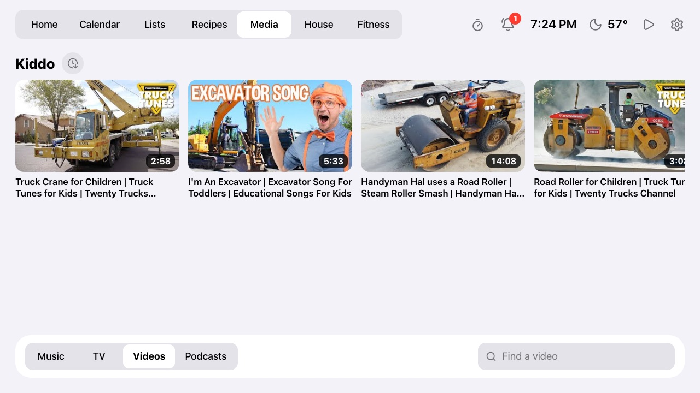
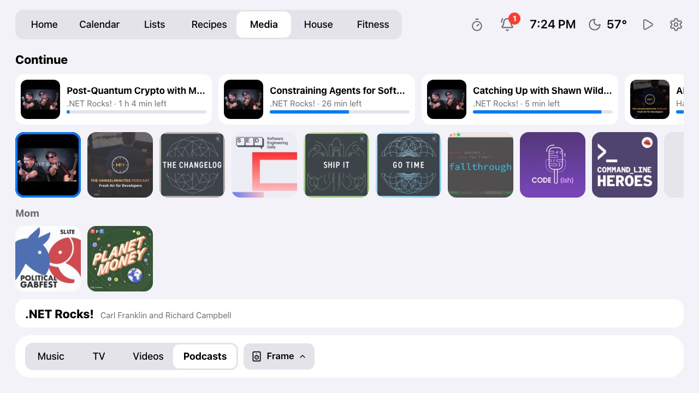
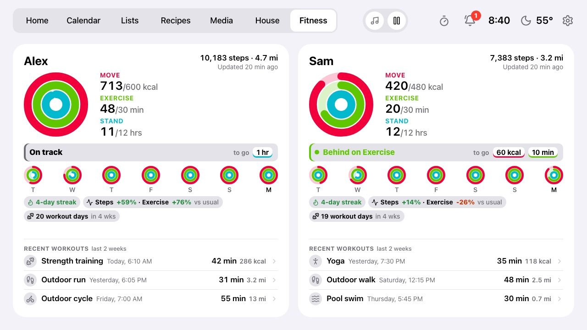
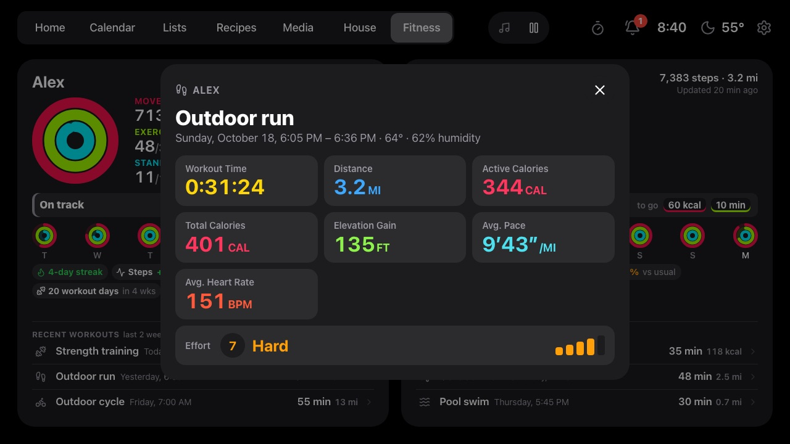
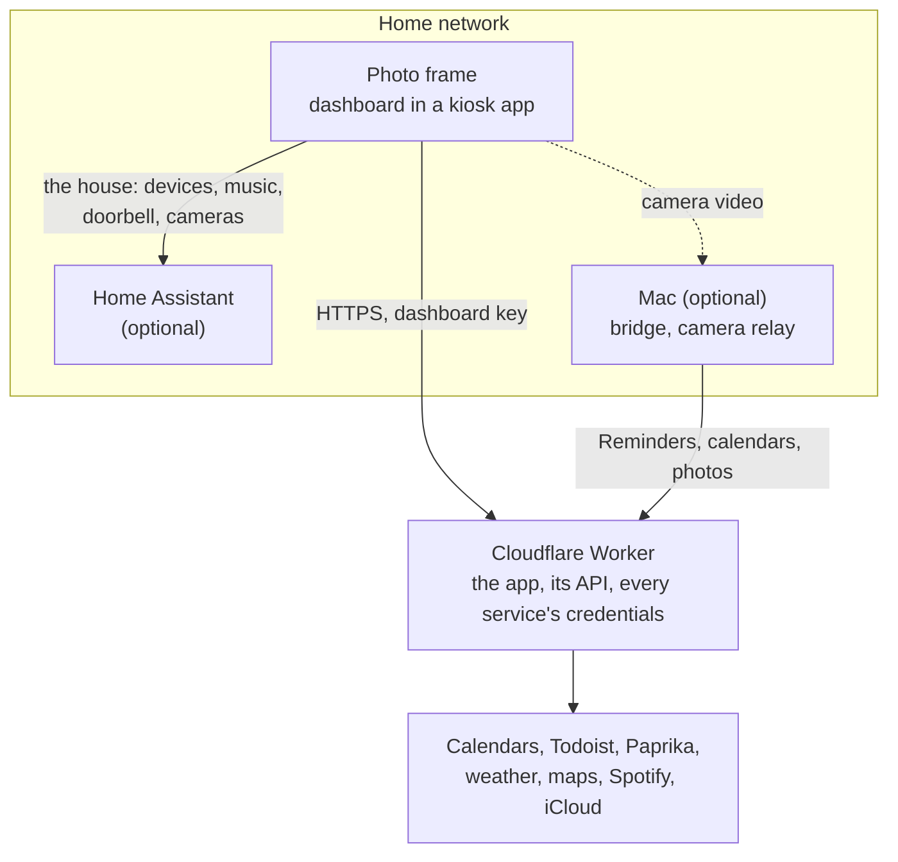

# Photo Frame Dashboard

A calm family dashboard for a cheap Android photo frame on the kitchen wall: clock, weather, the
family calendar, [Todoist](https://www.todoist.com) tasks and groceries,
[Paprika](https://www.paprikaapp.com) recipes and meal plans, music,
[Home Assistant](https://www.home-assistant.io) devices, a doorbell camera pop-up, messages from AI agents, and a photo
slideshow when nobody's looking. It runs on a $50–100-ish Android photo frame and a
[Cloudflare Worker](https://workers.cloudflare.com) (free plan).

The frame this fork uses is the **Pastigio 15.6" Frameo** (board `FRAME156`, 1920×1080, Android
8.1). It's sold in several finishes; check the screen size, as the same name also covers 10.1"
models. Wes's [device table](https://github.com/wesbos/photo-frame-dashboard/blob/main/docs/devices.md)
lists other frames that work.


| Calendar (dark, after sunset) | Lists | Recipes |
| --- | --- | --- |
|  |  |  |

| Recipe with timers in its directions | Media (music) | House |
| --- | --- | --- |
|  |  |  |

| Media (videos for the kids) | Media (podcasts) | Weather (tap it): rain radar |
| --- | --- | --- |
|  |  |  |

| Fitness, from each person's iPhone | A workout (tap it) | An event (tap it) |
| --- | --- | --- |
|  |  |  |

Screenshots use the built-in demo mode (Settings → About → Demo mode, or `?demo=on`): the calendar,
lists, rotations, notices and two people's fitness are invented, the meal plan is made from Paprika recipes, and the slideshow
shows stock photos from [Lorem Picsum](https://picsum.photos). With Home Assistant connected, House and
Media show the real devices and speakers under made-up names (`DEMO_NAMES`, so "Mom" rather than a
real name), stock camera pictures and public playlists, and the radar is centred on Kansas City rather
than home. The weather is real. It's also handy for showing the frame to people without your own
calendar and lists on it. `?tab=`, `?media=tv|videos|podcasts`, `?open=<recipe id>`,
`?explore=<category>`, `?timer=Pasta:7`, `?weather=<day>` (with `&radar` for the radar),
`?settings=<tab>`, `?workout=<n>` and `?fitnessday=<n>` (with `?tab=fitness`), `?notices=<n>` and
`?np=off` (nothing playing) set up a particular screen.

## Thanks

This is a fork, and it stands on two people's work:

- **[Wes Bos](https://github.com/wesbos)** had the idea and showed it works: his video
  [Taking over Android photo frames](https://youtu.be/ZLycoUMltNI) and his repository
  [wesbos/photo-frame-dashboard](https://github.com/wesbos/photo-frame-dashboard), with the device
  guides for unlocking many frame models.
- **[Hunter Yeagley](https://github.com/huntsyea)** built
  [huntsyea/kitchen-frame](https://github.com/huntsyea/kitchen-frame), which this repository is
  forked from: the Svelte dashboard, the Cloudflare Worker (calendar, weather, Todoist, photos,
  recipes, agent messages), the Music tab, the kiosk app and the frame setup notes.

Go watch the video and star both repositories. See [CREDITS.md](CREDITS.md) for the rest.

## What this fork adds

**New** marks something the original didn't have; **Updated** marks a change to something it did.
Each feature links to its page in [`docs/`](docs/), which has the setup and the details; the
[Features](#features) section below has the short version of each.

### Home Assistant

| Feature | | What it does |
| --- | --- | --- |
| **[House tab](docs/house.md)** | New | Mirrors one HA dashboard, live: tap to toggle, thermostat setpoints tinted by heating/cooling, HA-rendered markdown, camera pictures that refresh on a schedule, and a camera full screen on tap (live video where the frame can play it). An unlock PIN. |
| **[Doorbell pop-up](docs/doorbell.md)** | New | A ring fills the screen with that doorbell's camera, live video or the latest snapshot, for 90 seconds. Found automatically. |
| **[Notices](docs/notices.md)** | New | HA automations post banners such as "Garage freezer is 18°F" (with the time each started) that clear themselves; a bell counts the ones still on and keeps the last 24 hours. Blueprints for temperature limits and thermostat changes. |
| **[Announcements](docs/announcements.md)** | New | Said out loud on a speaker from HA (an Echo's Announce, or text-to-speech): event reminders for the calendars you pick ("In 30 minutes: Swim lesson"), red alerts such as a leak at a louder volume and at night, optionally orange ones, and agent messages. Nothing during night hours, and `#quiet` in an event keeps it from being said. Off until turned on. |
| **[Presence](docs/presence.md)** | Updated | With motion sensors in an HA area (the kitchen, say), the clock screen waits until nobody has been seen for a while, and goes away when someone walks in. |
| **[Media](docs/music.md)** | Updated | Spotify through HA: Spotify Connect speakers, every playlist, what's playing from, Up next, Now Playing on Home and every tab's top bar, controls that answer at once, and starting from silence on an Echo. **TV**: any TV in HA, with what's playing, controls, its apps and an on-screen remote. **Videos**: chosen YouTube videos and playlists as big thumbnails for kids, played full screen. **[Podcasts](docs/music.md#podcasts-apple-podcasts-through-the-mac)**: Apple Podcasts through a Mac at home, with a Continue row of half-played episodes and rows of someone else's shows, played on the frame or on an Echo. |

### In the kitchen

| Feature | | What it does |
| --- | --- | --- |
| **[Paprika recipes](docs/recipes.md)** | New | Your library, synced: categories, search, an A–Z index, notes, nutrition and full-size photos. **Save to Paprika** from Explore (recipes already there are marked). A script fixes recipes whose imports only got a thumbnail, in Paprika itself. |
| **Meal plan** | New | Paprika's planned meals on Home ("Dinner" at the top of Today) and a Meals view for the week, which updates when the plan changes. **[Groceries for the week](docs/recipes.md#groceries-for-the-week)**: one shopping list from the week's planned recipes, combined and added up, staples and what's already on the list left out, to check over before adding (an open-weight model on Workers AI, free). |
| **[Rotations](docs/rotations.md)** | New | Who's up early with the kids, whose turn for bedtime, on Home's Today card. |
| **[Timers](docs/timers.md)** | New | Tap a time, then a name (Pasta, Oven). Times in recipe directions are buttons. A chip on every screen, then a chime, a full-screen alert and an Echo announcement. |
| **[Lists](docs/lists.md)** | Updated | Groceries and Tasks in one tab, and side by side on Home. Each from Todoist or, through a Mac at home, Apple Reminders (Siri, the watch and the phone, two-way within seconds), with priorities, due times, aisles and flags. Tap an item to edit it; ticking one gives a few seconds to undo. |
| **[Alexa](docs/alexa.md)** | New | Your own private Alexa skill: "Alexa, ask Kitchen Frame to add eggs to groceries" (the frame then shows the list), show a tab, start the slideshow, play a group of videos or a podcast on the Echo, what's for dinner, the rundown of the day, how's my fitness (an AI summary of the rings, the week and workouts), or guest mode on. What each Echo heard and what the skill did are logged on the status page. |

### At a glance

| Feature | | What it does |
| --- | --- | --- |
| **[Fitness](docs/fitness.md)** | New | Each person's Activity rings, steps and recent workouts from their own iPhone: a Fitness tab with the last 7 days (tap a day), streaks and today against their usual, workout details (tap one), and their rings on Home under the clock. Behind on a ring stands out; all three closed gets a check. **Guest mode** hides it all while there's company. |
| **[Weather](docs/weather.md)** | Updated | The UV right now on Home (for sunscreen) and a three-day forecast. Tap for a day's sheet: the National Weather Service forecast text (US), alerts, hours ahead, wind, the day's peak UV, sun times, and a **radar** of the last hour and the next two. |
| **[Calendar](docs/calendar.md)** | Updated | Upcoming grouped by day, colours and names per calendar, tap an event for its details, a map of where it is, and notes on the calendars you choose, hide any calendar per frame, `#private` to keep an event off the frame, and `#quiet` to show it but never announce it. A failing feed is retried less and less often while its last good events stay up, and a feed that rarely changes (a season's games) can be fetched only every few hours. |
| **Settings** | Updated | In tabs (Display, Announcements, Home, About), backed up to the Worker (after a reset the frame takes its choices back), with the version and build time on About, and a QR code to pair the iPhone app. Demo mode shows invented calendars and lists, and with Home Assistant connected, the real House and Media under made-up names. |
| **Clock screen** | Updated | Never while a recipe is open or a timer is running; 30 minutes by default (up to two hours); a red night clock that brightens a little when someone's in the room. Photos stay bright after sunset while the room is lit, and dim when it's dark (an HA light sensor). Classic iCloud shared album links work for the slideshow, and through the Mac, album videos play in it and photos show when and where they were taken. |
| **[Status page](docs/frame.md#status-page-optional)** | New | A private page behind GitHub sign-in: is the frame online and what is it running, a day's timeline, its event log, the Alexa log, and the health of everything behind the dashboard: each feed, the Paprika sync's last check, each phone's last fitness send. |

### On your phone

| Feature | | What it does |
| --- | --- | --- |
| **[iPhone app](ios/README.md)** | New | Share a photo or video from Photos to the frame, full screen with pinch-to-zoom and when and where it was taken, or a YouTube link to play there. A remote to show any screen, start the slideshow, wake it or turn on guest mode. Its owner's Activity rings and workouts for [Fitness](docs/fitness.md), from Apple Health. The status page as an Ops tab. Pairs by scanning a QR code on the frame; built with Xcode, not from the App Store. |

## How it fits together



The frame talks to the Worker for everything but the house, and to Home Assistant directly on the
home network. The Worker holds every service's credentials, so the frame never does. Details,
with a diagram for each side: [docs/architecture.md](docs/architecture.md).

## Getting started

**Status:** this fork runs on a Pastigio FRAME156 (Android 8.1, 1920×1080), with its WebView upgraded
from the vendor's 106 to 138, the last for Android 8.1 ([docs/webview.md](docs/webview.md): about a
quarter faster tab switches, and three years of security fixes). Its device
record, every change made to it and how to undo each one are in [docs/frame.md](docs/frame.md).

### What you need

**Required**

- A frame running the [kiosk app](kiosk/README.md) (or any browser, to try it).
- A Cloudflare account (the free plan). The Worker is written for Cloudflare Workers: it keeps its
  data in Cloudflare's storage (KV and Durable Objects), holds the live connections to the frame and
  the Mac there, and runs the calendar and Paprika on Cloudflare's schedules. Running it elsewhere
  would mean porting those (untried).
- At least one calendar link, for Home and the Calendar tab to have something to show.

**Optional**

Each is independent, and only if you want what it gives; leave any out and the rest works as before.

- **Home Assistant**, if you want the house on the frame: the House tab, Music and TV, the doorbell
  pop-up, notices, spoken announcements and timer alerts, and a clock screen that follows motion.
  Without it those tabs and features don't show.
- **Todoist or Apple Reminders**, if you want the Groceries and Tasks lists. Todoist needs only a
  token; Reminders needs the Mac bridge (below). Without either, the lists say they aren't connected.
- **Paprika**, if you keep your recipes and meal plan there. Without it, Recipes still has Explore
  (TheMealDB) and Saved.
- **Spotify** (the Worker's own connection), if you want every playlist on the Music tab, not just
  what Home Assistant offers.
- **An iCloud shared album**, if you want photos behind the clock screen. Without one, the clock
  shows on its own.
- **An always-on Mac**, if you want any of: Apple Reminders lists; iCloud calendars with their
  alerts, or iCloud calendars and the album without public links (the
  [Mac bridge](docs/mac-bridge.md)); live video from Home Assistant cameras too big for your frame's
  video decoder (the [camera relay](bridge/camera-relay/README.md)).
- **An agent token**, if you want AI agents or scripts to post messages to the frame or save
  recipes.
- **An Amazon developer account and an Echo**, if you want to talk to the frame through Alexa (a
  skill of your own, never published).

### Layout

Each part has a short README of its own: what it is, when you need it, how to build or install it.

- [`dashboard/`](dashboard/README.md): the web app the frame shows ([`src/`](dashboard/src)), the
  Cloudflare Worker behind it ([`worker/`](dashboard/worker)), the optional status page
  ([`ops/`](dashboard/ops)) and the day-to-day [`scripts/`](dashboard/scripts). Always needed.
- [`kiosk/`](kiosk/README.md): the Android app the frame boots into (one full-screen WebView). For an
  Android frame.
- [`ios/`](ios/README.md): the optional iPhone app: share photos, videos and YouTube links to the
  frame, and a remote for it. Built with Xcode; not on the App Store.
- [`bridge/mac/`](bridge/mac/README.md): the optional Mac bridge, for Apple Reminders lists, Apple
  Podcasts, and iCloud calendars (with alerts) and a shared album without public links
  ([docs/mac-bridge.md](docs/mac-bridge.md)).
- [`bridge/camera-relay/`](bridge/camera-relay/README.md): the optional camera relay for a Mac, for
  cameras too big for your frame's video decoder.
- [`homeassistant/`](homeassistant/README.md): the announce script and notice blueprints to import
  into Home Assistant.
- [`docs/`](docs): a page per feature (setup, settings, what happens when), plus
  [architecture](docs/architecture.md) and the frame's own record ([frame.md](docs/frame.md)).
- [`docs/research.md`](docs/research.md): what we learned from the upstream repo and the video, plus performance
  constraints. Clone [upstream](https://github.com/wesbos/photo-frame-dashboard) into
  `reference/photo-frame-dashboard/` (gitignored) to have its device guides at hand.

### Run

```sh
cd dashboard
npm install
npm run dev          # http://localhost:5173, also on the LAN for the frame
open "http://localhost:5173/?diag"   # perf overlay (fps, jank, DOM, image megapixels, heap)
```

Local settings: `cp dashboard/.dev.vars.example dashboard/.dev.vars` and fill it in, then open
`http://localhost:5173/#key=<DASHBOARD_KEY>` once (the page remembers the key). `npm test` runs the
Worker and parser tests.

### Deploy

From `dashboard/` (after `npx wrangler login`):

```sh
# In a fork, first remove the CALENDAR KV namespace "id" from wrangler.jsonc: it's this deployment's.
npm run deploy                 # the first deploy creates the KV namespace; then pin its id there
scripts/push-secrets.sh        # uploads every setting in .dev.vars as a Worker secret
curl -H "Authorization: Bearer <key>" "https://kitchen-frame.<your-subdomain>.workers.dev/api/calendar?refresh"
```

Point the kiosk at the Worker's address with `#key=<key>` (after `#`, so it never reaches the server), or build the full setup link with
`scripts/frame-url.sh` (see [docs/house.md](docs/house.md#setup)). After a deploy the frame picks
up the new version by itself within about 10–20 minutes, at a quiet moment, or at once with
`scripts/frame-status.sh --reload`.

### Cost

It runs on Cloudflare's **free** Workers plan: the frame makes roughly 1,500–2,000 Worker
requests a day against a 100,000 allowance, KV writes stay well under the 1,000 a day (the calendar
is only rewritten when it changes), and photo resizing is within the Images binding's free 5,000 a
month. Nothing here costs money beyond the frame.

## Features

### Calendar

The Worker merges any number of calendar feeds into one agenda (Google, iCloud, Fastmail,
Outlook/Exchange, or a subscribed .ics link such as a team's schedule); name and colour each one,
hide any of them per frame; `#private` in an event keeps it off the frame, and `#quiet` shows it but
never announces it. Choose which
calendars open when an event is tapped (`CALENDAR_DETAILS`): those show the day and time, the
location with a small map, and the event's notes; notes from other calendars are never stored.
[docs/calendar.md](docs/calendar.md) has how to get each kind of link, every setting, privacy
details, and how refreshing and failed feeds work.

### Weather

Open-Meteo needs no key, and in the US the same location brings the National Weather Service's
written forecast and alerts. The day sheet has a rain **radar** (last hour, now, next two hours)
from NWS and NOAA data in the US, RainViewer elsewhere. Setup and sources in
[docs/weather.md](docs/weather.md).

### Lists

Groceries and Tasks come from Todoist (an API token; the project names are settings) or, per list,
from Apple Reminders through a Mac at home that runs a small bridge app, two-way within seconds, so
"Hey Siri, add milk to my Groceries list" shows on the frame. [docs/lists.md](docs/lists.md)
compares the two, walks through the Mac, and lists what happens when the Mac is off.

### Recipes

Four views: **Meals** (the Paprika meal plan), **Paprika** (your library, synced every 15 minutes),
**Explore** (TheMealDB) and **Saved**. With a Paprika account, **Save to Paprika** on an Explore
recipe puts it in your library, photo included, under your matching category; recipes already there
wear a badge in Explore and say **In Paprika** on their page, and the Worker won't save a duplicate.
Recipes agents send go to Paprika too. Any recipe's ingredients can go to Groceries, and
**Groceries for the week** makes one list from all the week's planned recipes (combined and added up,
pantry staples and what's already on the list left out) to check over before adding. Paprika has no
official API, so the sync uses the undocumented one its apps use; a change there stops the sync, not
the frame. [docs/recipes.md](docs/recipes.md).

### Rotations

Who's up early with the kids, whose turn for bedtime, as lines on Home's Today card; by weekday or
alternating daily. Optional, and set as a Worker secret so names stay out of the repo.
[docs/rotations.md](docs/rotations.md).

### House tab

Mirrors one Home Assistant dashboard, live: tap to toggle, thermostats with setpoint buttons, HA's
markdown cards, camera pictures and live video. Give the frame HA's **home-network address** and a
**non-admin, local-only** HA user's token (its token is then useless outside the house). Unlocking a
lock takes two taps or a PIN. Cameras: live video plays when the frame's decoder can handle the
picture (the FRAME156's: up to 1920 wide), and refreshing pictures with their time otherwise. A
camera that sends more than your frame decodes can go through an optional relay on a Mac that
shrinks it; Ring cameras have extra steps (ring-mqtt). Setup, what each device does,
and the camera measurements are in [docs/house.md](docs/house.md).

### Media: music, TV, videos and podcasts

**Music** is Spotify on the house's speakers through Home Assistant, with controls that answer at
once and a Now Playing card everywhere. **TV** is any TV HA knows: what's playing, controls, apps and
an on-screen remote; behind a soundbar, `TV_AUDIO` sends volume to the speaker that actually plays
the sound. Setup (HA's Spotify integration, optionally Alexa Devices and the Worker's own Spotify
connection for every playlist) in [docs/music.md](docs/music.md).

**Videos** shows chosen YouTube videos and playlists (`YOUTUBE_VIDEOS`) as big thumbnails a kid can
tap, played full screen in YouTube's own player; it needs no Home Assistant. [docs/music.md](docs/music.md#videos-youtube-for-the-kids).
**Podcasts** are your Apple Podcasts library through a Mac at home, half-played episodes first, played
on the frame or on an Echo through the Alexa skill.
[docs/music.md](docs/music.md#podcasts-apple-podcasts-through-the-mac).

### Timers

Tap a time, then a name; times in recipe directions are buttons; up to three run, with a chip on
every screen, a chime, a full-screen alert, and with Home Assistant a spoken announcement on a speaker
(an Echo's, say). Names per frame with
`TIMER_NAMES`. [docs/timers.md](docs/timers.md).

### Clock screen, night and presence

After a while untouched the frame shows a clock over the photo slideshow, from an iCloud shared
album if you set one (never during a recipe or a timer). **Night** gives a dim red clock that motion
doesn't wake. Optionally, with Home Assistant and motion sensors in an HA
area (`PRESENCE_AREA`), the clock waits until nobody has been seen for a while and the dashboard
comes back when someone walks in; Settings → Home lists the sensors, and occupancy sensors start
left out since they hold "occupied" too long. The theme follows the sun (`?theme=` pins it).
[docs/presence.md](docs/presence.md).

### Doorbell

With Home Assistant and a doorbell in it, a ring covers the screen with that doorbell's camera for 90 seconds: snapshot first, live video when
it streams. Every HA event entity with device class `doorbell` is watched, with its device's camera,
so there's nothing to configure in the usual case (`DOORBELL` / `DOORBELL_CAMERA` override it).
[docs/doorbell.md](docs/doorbell.md).

### Fitness

With each person's iPhone app: their Activity rings, steps and recent workouts on a Fitness tab
(today, the last 7 days, streaks and today against their usual, a workout's details on a tap) and
their rings on Home. Only those numbers leave the phone, and average heart rate only if its owner
turns it on. **Guest mode** (on the frame, the app's Settings, or Alexa to turn it on) hides it while guests
are over. [docs/fitness.md](docs/fitness.md).

### Notices

With Home Assistant: short banners from its automations that clear themselves ("Garage freezer is 18°F"), red,
orange or blue, with a bell that counts new ones and a sheet of the last 24 hours. Any HA persistent
notification whose id starts with `frame_` shows, so the device-specific logic stays in your
automations; `frame_alert_…` is red, `frame_info_…` blue. Blueprints for temperature limits and
thermostat changes are in `homeassistant/blueprints/`. [docs/notices.md](docs/notices.md).

### Announcements

With Home Assistant and a speaker it can talk through. Settings → Announcements (off until you turn it on): the speaker, an announcement volume and a
louder alert volume, **event reminders** per calendar ("In 30 minutes: Swim lesson"), red alerts
said aloud (at night too, if you choose), optionally orange ones, and agent messages. It speaks
through `script.frame_announce` from `homeassistant/scripts/`, which sets the volume and puts the
speaker's own back afterwards. [docs/announcements.md](docs/announcements.md).

### Alexa

A skill of your own on your Amazon account, in development, never published: "Alexa, ask Kitchen Frame
to add eggs to groceries", "…show the calendar", "…play Trucks videos", "…what's for dinner", "…for the rundown",
"…how's my fitness", "…we have guests".
[docs/alexa.md](docs/alexa.md).

### Messages from agents

AI agents can post full-screen messages to the frame with their own token, and have them read
aloud. [docs/messages.md](docs/messages.md).

### iPhone app

A small app built with Xcode (a free Apple account is enough for your own phone). From the share sheet,
a photo or video shows full screen on the frame (pinch to zoom, with when and where it was taken),
and a YouTube link plays there. It's also a remote for showing any screen, starting the slideshow,
waking the frame or turning on guest mode; sends its owner's Activity rings and workouts for
[Fitness](docs/fitness.md); and has the status page as an Ops tab. It pairs by scanning a QR code in
the frame's Settings. [ios/README.md](ios/README.md).

## The frame

The frame boots into our own kiosk app (`kiosk/`, package `com.huntsyea.frame`): build it with
`kiosk/build.sh`, install with `adb install -r kiosk/build/frame.apk`, and set the dashboard URL
once with `adb shell am start -n com.huntsyea.frame/.MainActivity -d '<url with #key=>'`.

The frame checks in with the Worker every 10 minutes with its versions, what it's showing and an
event log (connection drops, failed actions, cameras, locks, announcements, errors), and its
settings are backed up with it. `dashboard/scripts/frame-status.sh --log` shows the log from
anywhere, `--now` asks the frame to check in first, and `--reload` has it reload the dashboard; the
optional **status page** shows the same, plus the backend's health, behind GitHub sign-in.

[docs/frame.md](docs/frame.md) has getting ADB working, every change made to the device with its
undo command, day-to-day operation, troubleshooting, the status page, and setting up a different
frame. [SECURITY.md](SECURITY.md) has what each secret opens and what to do if the frame is lost.

## Contributing

Issues and pull requests are welcome; see [CONTRIBUTING.md](CONTRIBUTING.md). Report security
problems privately as described in [SECURITY.md](SECURITY.md).

## Credits and license

Inspired by [Wes Bos](https://github.com/wesbos/photo-frame-dashboard)
([video](https://youtu.be/ZLycoUMltNI)) and forked from
[Hunter Yeagley's kitchen-frame](https://github.com/huntsyea/kitchen-frame). Weather data by
[Open-Meteo](https://open-meteo.com) and the [National Weather Service](https://www.weather.gov),
recipes from [TheMealDB](https://www.themealdb.com), maps from [OpenStreetMap](https://www.openstreetmap.org/copyright),
icons from [Lucide](https://lucide.dev). Full credits in [CREDITS.md](CREDITS.md).

Released under the [MIT License](LICENSE).
