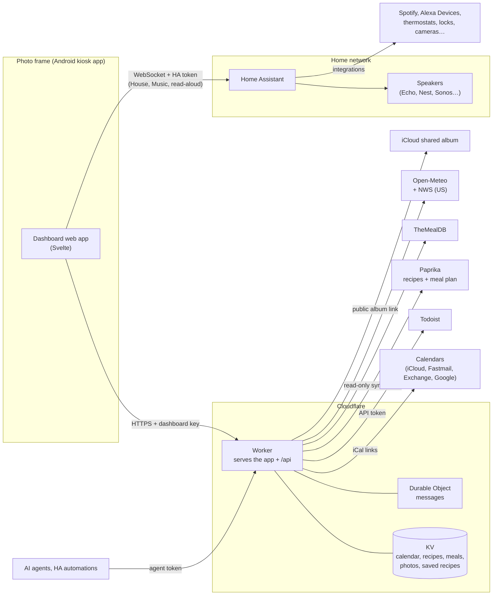

# Photo Frame Dashboard

A calm family dashboard for a cheap Android photo frame on the kitchen wall: clock, weather, the
family calendar, [Todoist](https://www.todoist.com) tasks and groceries,
[Paprika](https://www.paprikaapp.com) recipes and meal plans, music,
[Home Assistant](https://www.home-assistant.io) devices, messages from AI agents, and a photo
slideshow when nobody's looking. It runs on a $50–100-ish Android photo frame and a
[Cloudflare Worker](https://workers.cloudflare.com) (free plan).

The frame this fork uses is the **Pastigio 15.6" Frameo** (board `FRAME156`, 1920×1080, Android
8.1). It's sold in several finishes; check the screen size, as the same name also covers 10.1"
models. Wes's [device table](https://github.com/wesbos/photo-frame-dashboard/blob/main/docs/devices.md)
lists other frames that work.


| Calendar (dark, after sunset) | Lists | Recipes |
| --- | --- | --- |
|  |  |  |

| Recipe with step timers | Music | House |
| --- | --- | --- |
|  |  |  |

| Weather details (tap the weather) |
| --- |
|  |

Screenshots use the built-in demo mode, so all data shown is invented, apart from the weather.

## Thanks

This is a fork, and it stands on two people's work:

- **[Wes Bos](https://github.com/wesbos)** had the idea and showed it works: his video
  [Taking over Android photo frames](https://youtu.be/ZLycoUMltNI) and his repository
  [wesbos/photo-frame-dashboard](https://github.com/wesbos/photo-frame-dashboard), with the device
  guides for unlocking many frame models.
- **[Hunter Yeagley](https://github.com/huntsyea)** built
  [huntsyea/kitchen-frame](https://github.com/huntsyea/kitchen-frame), which this repository is
  forked from: the Svelte dashboard, the Cloudflare Worker (calendar, weather, Todoist, photos,
  recipes, agent messages), the Music tab, the kiosk app and the frame setup notes.

Go watch the video and star both repositories. See [CREDITS.md](CREDITS.md) for the rest.

## What this fork adds

- **House tab:** mirrors one Home Assistant dashboard, so editing it in HA changes the frame (live).
  Tap devices to toggle (unlocking takes two taps), thermostats get setpoint buttons and are tinted
  by what they're doing, markdown cards and the view header are rendered by HA, and camera
  snapshots refresh only when tapped. See [House tab](#house-tab-home-assistant-devices).
- **Weather details:** tap the weather on Home (or in the header) for a day's detail sheet: the
  National Weather Service's written day and night forecast (US only), active alerts, the hours
  ahead, rain, wind, UV and sun times. An active alert also shows as a badge on Home's weather card.
- **Lists tab:** Groceries and Tasks share one tab with a switch, and Home stacks both lists
  beside the calendar; tap a heading to jump to that list.
- **Kitchen timers:** a timer button in the top bar (tap a time, then optionally a name like
  Pasta or Oven), times in recipe steps you can tap ("bake ⏱ 25 minutes"), a countdown chip on
  every screen, and when one ends a chime on the frame, a full-screen alert, and an announcement on
  a Home Assistant speaker ("Your 5 minute bread timer is done"). See [Timers](#timers).
- **Meal plan:** Paprika's planned meals show on Home ("Dinner" at the top of Today, tap to open
  the recipe) and in a Meals view in Recipes for the coming week.
- **Our own recipes:** a read-only Paprika sync adds a Paprika view to Recipes. See
  [Our recipes from Paprika](#our-recipes-from-paprika).
- **Spotify:** the Music tab works with Home Assistant's Spotify integration: Spotify Connect
  speakers, playlists, and starting from silence on an Echo (through HA's Alexa Devices).
- **Calendar privacy:** `#private` in an event's title or notes keeps it off the frame.
- **Photos:** classic iCloud shared album links (`icloud.com/sharedalbum/#…`) work, and videos in
  the album show as their cover frame.
- **Setup links:** the dashboard key and Home Assistant settings can be handed over in the URL
  once, and are then removed from it (`dashboard/scripts/frame-url.sh` builds the link).
  `?demo=on`, `?tab=`, `?open=<recipe id>` and `?timer=Pasta:7` help with screenshots.
- **Demo mode** also covers the Music tab (an invented player and speakers) and the House tab (an
  invented house), and has a made-up meal plan.
- Smaller: a roomier calendar on Home, a three-day forecast, and idle times up to two hours.

## How it fits together



- **The frame** holds only the dashboard key and its Home Assistant token (a non-admin HA user).
- **The Worker** holds every other credential as Cloudflare secrets and caches what it fetches in
  KV, so the frame never talks to Todoist, Paprika, iCloud or calendar servers itself. A cron
  refreshes calendars every 10 minutes and syncs Paprika every 15.
- **Home Assistant** is reached directly on the home network, never through Cloudflare.
- **Secrets** go from `dashboard/.dev.vars` (gitignored) to Cloudflare with
  `dashboard/scripts/push-secrets.sh`; frame settings go to the frame with
  `dashboard/scripts/frame-url.sh`.

## Status

Upstream runs on a Pastigio FRAME156 (Android 8.1, WebView 106, 1920×1080). Its device record,
every change made to it and how to undo each one are in [docs/frame.md](docs/frame.md). This fork
targets the same 15.6" frame.
The developer wiki is in [openwiki/](openwiki/quickstart.md).

## Layout

- `dashboard/src/`: the web app (Svelte 5, no SvelteKit). Tabs: Home (clock, weather, today's
  events, groceries, to-dos), Calendar (week and month), Lists (Groceries and Tasks, from Todoist),
  Recipes (Paprika, TheMealDB and saved recipes), Music and House (both Home Assistant). After a
  set time untouched (Settings) it switches to an idle clock and photo screen. The frame loads it full screen in a kiosk WebView.
- `dashboard/worker/`: the Cloudflare Worker that serves the app and its API: merged calendar,
  weather (Open-Meteo), Todoist lists, the iCloud shared album (photos proxied and cached in KV),
  recipes (Paprika's library and meal plan, TheMealDB, saved ones) and agent messages (a Durable
  Object that pushes them to the frame over a WebSocket). Tokens and links for those services stay
  on the server.
- `docs/research.md`: what we learned from the upstream repo and the video, plus performance constraints.
- `kiosk/`: the Android app the frame boots into (one full-screen WebView). `kiosk/build.sh` builds it
  without Gradle; see `docs/frame.md` for the install and the changes made to our frame.
- `reference/photo-frame-dashboard/`: upstream clone, gitignored. Re-create with
  `git clone https://github.com/wesbos/photo-frame-dashboard reference/photo-frame-dashboard`.

## Run

```sh
cd dashboard
npm install
npm run dev          # http://localhost:5173, also on the LAN for the frame
open "http://localhost:5173/?diag"   # perf overlay (fps, jank, DOM, image megapixels, heap)
```

## Calendar

The Worker merges any number of iCal links into one agenda. A cron job refreshes them into KV
every 10 minutes, writing KV only when something changed (or hourly), and the page polls every 5.
If a feed fails, its last good events stay up.

How often the frame polls each feed (`start()` in `src/lib/state.svelte.js`): calendar every 5
minutes, weather every 15, the meal plan every 30, Tasks every minute while the dashboard is up,
Groceries every minute while Home or its list is showing, photos every 5 minutes only while the
slideshow is showing photos, and nothing for messages, which are pushed over a WebSocket the moment
they're sent ([docs/messages.md](docs/messages.md)). A poll waits for the previous one to finish,
and unchanged results don't redraw the screen. That's roughly 1,500–2,000 Worker requests a day per
frame.

**Cost:** it runs on Cloudflare's **free** Workers plan. Free allows 100,000 requests and 1,000 KV
writes a day; the calendar is only rewritten when it changes (or hourly), and Paprika recipes and
photos are written once each. The Images binding (resizing photos once) is free up to 5,000
transformations a month. Workers Paid ($5/month) is only worth it if a very large calendar outgrows
the free plan's CPU limit for the cron (see below).

Calendar links (each is effectively a password: anyone with one can read that calendar):

- **Google:** Settings → your calendar → *Integrate calendar* → **Secret address in iCal format**.
- **Apple (iCloud):** Calendar app → right-click the calendar → *Share Calendar* → **Public
  Calendar** → copy the `webcal://` link (used as-is).
- **Fastmail:** Settings → Calendars → the calendar's sharing settings → **Publish**, full details →
  copy the .ics link.
- **Outlook / Microsoft 365 (Exchange):** Outlook on the web → Settings → Calendar → Shared calendars
  → **Publish a calendar** ("Can view titles and locations") → copy the **ICS** link. Some
  organisations turn publishing off.

The frame shows each event's title, time and location only, never descriptions or attendees.
Calendars are colour-coded by their order in `CALENDAR_URLS`, and each device can hide any of them
(**Calendars** on Home or the Calendar tab). `CALENDAR_NAMES` (optional, comma-separated, same order)
names them in that list when a feed's own name isn't useful (Exchange calls everything "Calendar").

To keep an event off the frame (a surprise, say), put `#private` in its title or notes, or mark it
Private in your calendar app. The Worker drops it before the frame ever sees it. It's still in the
published feed, so this hides it from the kitchen, not from anyone who has the link.

Local dev: `cp dashboard/.dev.vars.example dashboard/.dev.vars`, fill it in, `npm run dev`, then
open `http://localhost:5173/?key=<DASHBOARD_KEY>` once (the page remembers the key).
`npm test` runs the Worker and parser tests (calendar fixtures in `worker/fixtures/`, Paprika,
photos, messages and the House dashboard parser).

Deploy from `dashboard/` (after `npx wrangler login`):

```sh
# In a fork, first remove the CALENDAR KV namespace "id" from wrangler.jsonc: it's this deployment's.
npm run deploy                 # the first deploy creates the KV namespace; then pin its id there
scripts/push-secrets.sh        # uploads every setting in .dev.vars as a Worker secret
curl -H "Authorization: Bearer <key>" "https://kitchen-frame.<your-subdomain>.workers.dev/api/calendar?refresh"
```

Point the kiosk at `https://kitchen-frame.<your-subdomain>.workers.dev/?key=<key>`, or build the
full setup link with `scripts/frame-url.sh` (see [House tab](#house-tab-home-assistant-devices)).

The free plan allows 10 ms of CPU per cron run (Workers Paid allows 30 s). Old one-off events are
skipped before parsing and long-running repeats are fast-forwarded, so a typical family calendar
fits; a very large one may need Paid.

## Light and dark

The theme follows the sun: light from sunrise to sunset (from the weather feed), dark otherwise,
with 7 AM / 7 PM as the fallback before weather loads. On the idle clock screen the clock uses the
colour chosen in Settings and dims at night, as do the photos (or they're off at night, per Settings). Pin a
theme with `?theme=light` or `?theme=dark` (remembered on the frame); `?theme=auto` goes back to
following the sun. Both themes are CSS variables, so switching costs one repaint and no memory.

## Weather and Todoist

- **Weather:** set `WEATHER_LAT` and `WEATHER_LON` (plus `WEATHER_UNIT="celsius"` if you want it)
  as secrets (`npx wrangler secret put`, as this deployment does) or `vars` in
  `dashboard/wrangler.jsonc`, and in `.dev.vars` locally. Open-Meteo needs no key. In the US the
  same location also brings the National Weather Service's written forecast and alerts (no key
  either); elsewhere the detail sheet just leaves them out.
- **Todoist:** `npx wrangler secret put TODOIST_TOKEN` (Todoist → Settings → Integrations →
  Developer → API token). By default the lists read the projects named **Groceries** and
  **To-do**; `TODOIST_GROCERY_PROJECT` / `TODOIST_TODO_PROJECT` in `wrangler.jsonc` point them
  elsewhere (this deployment uses "Groceries" and "Family"). Tapping an item completes
  it in Todoist, and items can be added from the frame.

## Our recipes from Paprika

Optional. With `PAPRIKA_EMAIL` and `PAPRIKA_PASSWORD` set (a Paprika Cloud Sync account), the
Recipes tab gets a **Paprika** view: your Paprika library with its categories, favourites and
Surprise me, and "Add to Groceries" as for any recipe. Search by name, or tap a letter on the A–Z
strip down the right edge to jump through a long library. A recipe shows your Paprika notes beside
it, plus its description and nutrition (tap to expand) when it has them. A cron reads the library every 15 minutes,
fetching only new or changed recipes, a batch at a time, and stores them with resized photos. It
never writes to Paprika. Paprika has no official API, so this uses the undocumented one its apps
sync with (see `dashboard/worker/paprika.js`); if that changes, the last copy keeps showing.

The same sync reads Paprika's meal plan (2 days back to 3 weeks ahead): today's meals appear at the
top of Home's Today list, and Recipes gets a **Meals** view of the next seven days.

## House tab (Home Assistant devices)

With a Home Assistant URL, token and dashboard set on the frame, a **House** tab mirrors that HA
dashboard: its headings become groups, tiles become devices you can tap (lights, fans, switches,
locks, covers, scenes), thermostats get setpoint buttons, sensors show their values, markdown cards
(including the view header) are rendered live by HA, and cameras show a snapshot that refreshes only
when tapped. Edit the dashboard in HA and the frame follows. Unlocking takes two taps. Use a
non-admin HA user's token.

Put `DASHBOARD_URL`, `HA_URL`, `HA_TOKEN` and `HA_DASHBOARD` in the gitignored `dashboard/.frame.vars`,
then `open "$(dashboard/scripts/frame-url.sh)"` (a browser) or pass the same URL to the kiosk with
`adb shell am start … -d`. The page saves the settings and removes them from the address bar.

## Timers

Start one from the timer button in the top bar: tap a time (it starts at once), then optionally a
name. The names default to Pasta, Bread, Veggies, Oven and Protein; set your own per frame with
`TIMER_NAMES` in `dashboard/.frame.vars` (or `?timer_names=` in a setup link). On a recipe page,
times in the steps are buttons that start a timer named after the recipe. Up to three can run; the
top bar on every screen shows one chip, the timer that ends next, with "+N" for the others (tap it
to see them all, add a minute or cancel). Timers survive a reload.

When a timer ends: the frame chimes (Web Audio, no sound files), a full-screen alert offers +1 min
or Dismiss, and, with Home Assistant, a speaker announces it through a `notify` entity, such as an
Echo's "Announce" from the Alexa Devices integration (Settings → Timer alerts; by default the one
with "kitchen" in its name). The frame has no microphone, so voice timers stay with your smart
speakers. The kiosk app (1.4+) lets the page play sound without a tap first.

## Messages from agents

AI agents can post full-screen messages to the frame: see [docs/messages.md](docs/messages.md).

## Recipes

Four views: **Meals** (the Paprika meal plan), **Paprika** (your library), **Explore** (TheMealDB) and
**Saved** (kept in the Worker; tap Save in Explore, or agents can send recipes). Any recipe's
ingredients can go to Groceries: see [docs/recipes.md](docs/recipes.md).

## The frame

The frame boots into our own kiosk app (`kiosk/`, package `com.huntsyea.frame`): build it with
`kiosk/build.sh`, install with `adb install -r kiosk/build/frame.apk`, and set the dashboard URL
once with `adb shell am start -n com.huntsyea.frame/.MainActivity -d '<url with ?key=>'`.
[docs/frame.md](docs/frame.md) covers getting ADB working, every change made to the device with
its undo command, day-to-day operation, and the Home Assistant setup for the Music tab.

To set up a different frame, start from the upstream device guides in
`reference/photo-frame-dashboard/docs/devices.md` (ADB, root, WebView 106, disabling the vendor
app; some vendor apps accept root commands from the vendor's server), set its time zone (event
times render in it), and measure it with `?diag`.

## Contributing

Issues and pull requests are welcome; see [CONTRIBUTING.md](CONTRIBUTING.md). Report security
problems privately as described in [SECURITY.md](SECURITY.md).

## Credits and license

Inspired by [Wes Bos](https://github.com/wesbos/photo-frame-dashboard)
([video](https://youtu.be/ZLycoUMltNI)) and forked from
[Hunter Yeagley's kitchen-frame](https://github.com/huntsyea/kitchen-frame). Weather data by [Open-Meteo](https://open-meteo.com) and the [National Weather Service](https://www.weather.gov),
recipes from [TheMealDB](https://www.themealdb.com), icons from [Lucide](https://lucide.dev).
Full credits in [CREDITS.md](CREDITS.md).

Released under the [MIT License](LICENSE).
