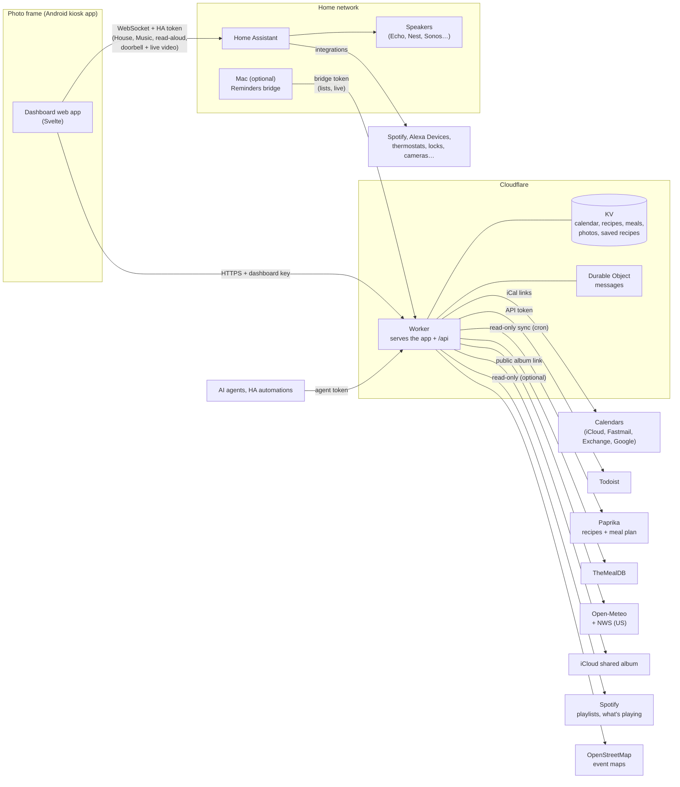
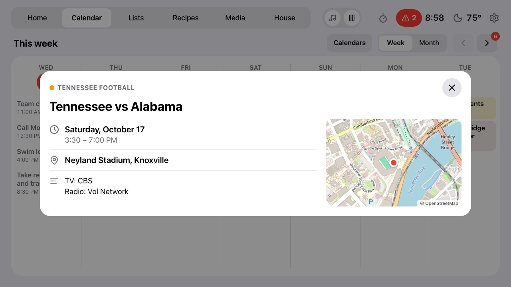
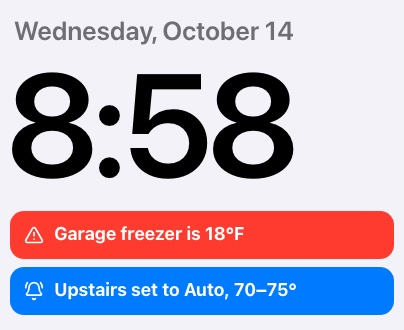

# Photo Frame Dashboard

A calm family dashboard for a cheap Android photo frame on the kitchen wall: clock, weather, the
family calendar, [Todoist](https://www.todoist.com) tasks and groceries,
[Paprika](https://www.paprikaapp.com) recipes and meal plans, music,
[Home Assistant](https://www.home-assistant.io) devices, a doorbell camera pop-up, messages from AI agents, and a photo
slideshow when nobody's looking. It runs on a $50–100-ish Android photo frame and a
[Cloudflare Worker](https://workers.cloudflare.com) (free plan).

The frame this fork uses is the **Pastigio 15.6" Frameo** (board `FRAME156`, 1920×1080, Android
8.1). It's sold in several finishes; check the screen size, as the same name also covers 10.1"
models. Wes's [device table](https://github.com/wesbos/photo-frame-dashboard/blob/main/docs/devices.md)
lists other frames that work.


| Calendar (dark, after sunset) | Lists | Recipes |
| --- | --- | --- |
|  |  |  |

| Recipe with timers in its directions | Music | House |
| --- | --- | --- |
|  |  |  |

| Weather details (tap the weather) |
| --- |
|  |

Screenshots use the built-in demo mode (Settings → Demo mode, or `?demo=on`), so all data shown is
invented, apart from the weather. It's also handy for showing the frame to people without your own
calendar and lists on it. `?tab=`, `?open=<recipe id>`, `?timer=Pasta:7` and `?weather=<day>` set up
a particular screen.

## Thanks

This is a fork, and it stands on two people's work:

- **[Wes Bos](https://github.com/wesbos)** had the idea and showed it works: his video
  [Taking over Android photo frames](https://youtu.be/ZLycoUMltNI) and his repository
  [wesbos/photo-frame-dashboard](https://github.com/wesbos/photo-frame-dashboard), with the device
  guides for unlocking many frame models.
- **[Hunter Yeagley](https://github.com/huntsyea)** built
  [huntsyea/kitchen-frame](https://github.com/huntsyea/kitchen-frame), which this repository is
  forked from: the Svelte dashboard, the Cloudflare Worker (calendar, weather, Todoist, photos,
  recipes, agent messages), the Music tab, the kiosk app and the frame setup notes.

Go watch the video and star both repositories. See [CREDITS.md](CREDITS.md) for the rest.

## What this fork adds

**New** marks something the original didn't have; **Updated** marks a change to something it did.

### Home Assistant

| Feature | | What it does |
| --- | --- | --- |
| **[House tab](#house-tab-home-assistant-devices)** | New | Mirrors one HA dashboard, live: tap to toggle, thermostat setpoints tinted by heating/cooling (kept the thermostat's minimum gap apart), HA-rendered markdown, camera snapshots with a Refresh button, and a camera full screen on tap (live video, sharper through ring-mqtt where the frame can play it). |
| **[Doorbell pop-up](#doorbell)** | New | A ring fills the screen with that doorbell's camera, live video or the latest snapshot, for 90 seconds. Found automatically. |
| **[Notices](#notices-from-home-assistant)** | New | HA automations post banners such as "Garage freezer is 18°F" that clear themselves. Blueprints for temperature limits and thermostat changes. |
| **[Presence](#clock-screen-and-presence)** | Updated | With motion sensors in an HA area (the kitchen, say), the clock screen waits until nobody has been seen for a while, and goes away when someone walks in. |
| **[Media](#media-music-and-tv)** | Updated | Spotify through HA: Spotify Connect speakers, every playlist (last played on any device, or A–Z) and what's playing from (a playlist, album, artist or autoplay), Up next, a card tinted with the cover's colour, Now Playing on Home and every tab's top bar, controls that answer at once, and starting from silence on an Echo. **TV**: any TV in HA, with what's playing, controls, its apps and an on-screen remote. |

### In the kitchen

| Feature | | What it does |
| --- | --- | --- |
| **[Paprika recipes](#our-recipes-from-paprika)** | New | A read-only sync of your library: categories (A–Z, plus Uncategorized), search, an A–Z index, your notes and nutrition, and the full-size photo. Tap a direction to mark your place; earlier ones are checked off. A script fixes recipes whose imports only got a thumbnail, in Paprika itself. |
| **Meal plan** | New | Paprika's planned meals on Home ("Dinner" at the top of Today) and a Meals view for the week. |
| **[Timers](#timers)** | New | Tap a time, then a name (Pasta, Oven). Times in recipe directions are buttons. A chip on every screen, then a chime, a full-screen alert and an Echo announcement. |
| **[Lists](#weather-and-lists)** | Updated | Groceries and Tasks in one tab, and side by side on Home. Each from Todoist or, through a Mac at home, Apple Reminders (Siri, the watch and the phone, two-way within seconds), with priorities, due times, aisles and flags. Tap an item to edit it; ticking one gives a few seconds to undo. |

### At a glance

| Feature | | What it does |
| --- | --- | --- |
| **Weather** | Updated | The UV right now on Home (for sunscreen) and a three-day forecast. Tap for a day's sheet: the National Weather Service forecast text (US), alerts, hours ahead, wind, the day's peak UV, sun times. |
| **[Calendar](#calendar)** | Updated | Upcoming grouped by day, colours and names per calendar, tap an event for its details and notes on the calendars you choose, hide any calendar per frame, and `#private` to keep an event off the frame. |
| **Clock screen** | Updated | Never while a recipe is open or a timer is running; 30 minutes by default (up to two hours). Classic iCloud shared album links work for the slideshow, and album videos show as a still. |

## How it fits together



- **The frame** holds only the dashboard key and its Home Assistant token (a non-admin HA user).
- **The Worker** holds every other credential as Cloudflare secrets and caches what it fetches in
  KV, so the frame never talks to Todoist, Paprika, iCloud or calendar servers itself. A cron
  refreshes calendars every 10 minutes and syncs Paprika every 15.
- **Home Assistant** is reached directly on the home network, never through Cloudflare. Doorbell
  live video comes over WebRTC, set up through that same connection.
- **Secrets** go from `dashboard/.dev.vars` (gitignored) to Cloudflare with
  `dashboard/scripts/push-secrets.sh`; frame settings go to the frame with
  `dashboard/scripts/frame-url.sh`.

## Status

Upstream runs on a Pastigio FRAME156 (Android 8.1, WebView 106, 1920×1080). Its device record,
every change made to it and how to undo each one are in [docs/frame.md](docs/frame.md). This fork
targets the same 15.6" frame.
The developer wiki is in [openwiki/](openwiki/quickstart.md).

## Layout

- `dashboard/src/`: the web app (Svelte 5, no SvelteKit). Tabs: Home (clock, weather, today's
  events, groceries, to-dos), Calendar (week and month), Lists (Groceries and Tasks, from Todoist),
  Recipes (Paprika, TheMealDB and saved recipes), Music (Spotify through Home Assistant) and House
  (Home Assistant). A doorbell
  ring shows its camera over every screen. After a
  set time untouched (Settings) it switches to an idle clock and photo screen. The frame loads it full screen in a kiosk WebView.
- `dashboard/worker/`: the Cloudflare Worker that serves the app and its API: merged calendar,
  weather (Open-Meteo), lists (Todoist, or Apple Reminders through the Mac bridge), the iCloud shared album (photos proxied and cached in KV),
  recipes (Paprika's library and meal plan, TheMealDB, saved ones) and agent messages (a Durable
  Object that pushes them to the frame over a WebSocket). Tokens and links for those services stay
  on the server.
- `bridge/mac/`: the optional Mac app that keeps Apple Reminders lists in step with the frame
  (Swift, EventKit; `install.sh` builds it and starts it at login). See `docs/lists.md`.
- `docs/research.md`: what we learned from the upstream repo and the video, plus performance constraints.
- `kiosk/`: the Android app the frame boots into (one full-screen WebView). `kiosk/build.sh` builds it
  without Gradle; see `docs/frame.md` for the install and the changes made to our frame.
- `reference/photo-frame-dashboard/`: upstream clone, gitignored. Re-create with
  `git clone https://github.com/wesbos/photo-frame-dashboard reference/photo-frame-dashboard`.

## Run

```sh
cd dashboard
npm install
npm run dev          # http://localhost:5173, also on the LAN for the frame
open "http://localhost:5173/?diag"   # perf overlay (fps, jank, DOM, image megapixels, heap)
```

Local settings: `cp dashboard/.dev.vars.example dashboard/.dev.vars` and fill it in, then open
`http://localhost:5173/?key=<DASHBOARD_KEY>` once (the page remembers the key). `npm test` runs the
Worker and parser tests (calendar, Paprika, photos, messages, weather, maps, Spotify and the House
dashboard parser).

Deploy from `dashboard/` (after `npx wrangler login`):

```sh
# In a fork, first remove the CALENDAR KV namespace "id" from wrangler.jsonc: it's this deployment's.
npm run deploy                 # the first deploy creates the KV namespace; then pin its id there
scripts/push-secrets.sh        # uploads every setting in .dev.vars as a Worker secret
curl -H "Authorization: Bearer <key>" "https://kitchen-frame.<your-subdomain>.workers.dev/api/calendar?refresh"
```

Point the kiosk at `https://kitchen-frame.<your-subdomain>.workers.dev/?key=<key>`, or build the
full setup link with `scripts/frame-url.sh` (see [House tab](#house-tab-home-assistant-devices)).
After a deploy the frame picks up the new version by itself within about 10–20 minutes, at a quiet
moment (Settings shows the running version).

**Cost:** it runs on Cloudflare's **free** Workers plan. The frame makes roughly 1,500–2,000 Worker
requests a day (calendar every 5 minutes, weather every 15, the meal plan every 30, lists every
minute while they're showing, Spotify playlists every 5 minutes while Music is showing, photos only
during the slideshow; messages are pushed, not polled).
Free allows 100,000 requests and 1,000 KV writes a day; the calendar is only rewritten when it
changes (or hourly), and Paprika recipes and photos are written once each. The Images binding
(resizing photos once) is free up to 5,000 transformations a month.

## Calendar

The Worker merges any number of calendar feeds into one agenda: Google, iCloud, Fastmail,
Outlook/Exchange, or a subscribed .ics link like a sports team's schedule. Put the links in
`CALENDAR_URLS`; optionally name and colour each one (`CALENDAR_NAMES`, `CALENDAR_COLORS`), and hide
any of them per frame from **Calendars** on Home or the Calendar tab. The frame shows titles, times
and locations, and `#private` in an event keeps it off the frame.

Choose which calendars open when an event is tapped (`CALENDAR_DETAILS`): the family calendar or a
team's schedule, say, but not work. Those events show a › and open a sheet with the calendar, the
day and time, the location with a small map, and the event's notes (TV channel and score, for a
sports feed). Notes
from other calendars are never stored, so the frame couldn't show them if it tried.



[docs/calendar.md](docs/calendar.md) has how to get each kind of link, every setting, privacy
details, and how refreshing and failed feeds work.

## Light and dark

The theme follows the sun: light from sunrise to sunset (from the weather feed), dark otherwise,
with 7 AM / 7 PM as the fallback before weather loads. On the idle clock screen the clock uses the
colour chosen in Settings and dims at night, as do the photos (or they're off at night, per Settings). Pin a
theme with `?theme=light` or `?theme=dark` (remembered on the frame); `?theme=auto` goes back to
following the sun. Both themes are CSS variables, so switching costs one repaint and no memory.

## Weather and lists

- **Weather:** set `WEATHER_LAT` and `WEATHER_LON` (plus `WEATHER_UNIT="celsius"` if you want it)
  as secrets (`npx wrangler secret put`, as this deployment does) or `vars` in
  `dashboard/wrangler.jsonc`, and in `.dev.vars` locally. Open-Meteo needs no key. In the US the
  same location also brings the National Weather Service's written forecast and alerts (no key
  either); elsewhere the detail sheet just leaves them out.
- **Todoist:** `npx wrangler secret put TODOIST_TOKEN` (Todoist → Settings → Integrations →
  Developer → API token). By default the lists read the projects named **Groceries** and
  **To-do**; `TODOIST_GROCERY_PROJECT` / `TODOIST_TODO_PROJECT` in `wrangler.jsonc` point them
  elsewhere (this deployment uses "Groceries" and "Family"). Tapping an item completes
  it in Todoist, and items can be added from the frame.
- **Apple Reminders instead** (per list): Apple gives servers no way into Reminders, so a Mac at
  home that stays on runs a small bridge app (`bridge/mac/`) that keeps chosen Reminders lists in
  step with the frame within seconds, both ways. "Hey Siri, add milk to my Groceries list" from the
  watch then shows on the frame, and ticking it on the frame ticks it on your phone.
  [docs/lists.md](docs/lists.md) compares it with Todoist (including Siri with Todoist), walks
  through setting up the Mac, and lists what happens when the Mac is off.

## Our recipes from Paprika

Optional. With `PAPRIKA_EMAIL` and `PAPRIKA_PASSWORD` set (a Paprika Cloud Sync account), the
Recipes tab gets a **Paprika** view: your Paprika library with its categories, favourites and
Surprise me, and "Add to Groceries" as for any recipe. Search by name, or tap a letter on the A–Z
strip down the right edge to jump through a long library. A recipe shows your Paprika notes beside
it, plus its description and nutrition (tap to expand) when it has them. A cron reads the library every 15 minutes,
fetching only new or changed recipes, a batch at a time, and stores them with resized photos. It
never writes to Paprika. Paprika has no official API, so this uses the undocumented one its apps
sync with (see `dashboard/worker/paprika.js`); if that changes, the last copy keeps showing.

The same sync reads Paprika's meal plan (2 days back to 3 weeks ahead): today's meals appear at the
top of Home's Today list, and Recipes gets a **Meals** view of the next seven days.

Photos come from a recipe's full-size photo in Paprika when it has one, otherwise Paprika's 280px
thumbnail. Many web imports only ever gave Paprika a thumbnail, which looks soft on the frame (and
in Paprika). `dashboard/scripts/paprika-photos.mjs`, run by hand on a Mac, fixes that in Paprika
itself: it finds the full photo on each recipe's source page, writes a before-and-after page to
look over, then uploads the ones you keep the way the Paprika app does, saving each recipe first
so `undo` can put it back. It's the one thing here that writes to Paprika. For sites that block
scripts, find the photo in a browser and give it to `use`. Run it with no arguments for its
commands.

## House tab (Home Assistant devices)

With a Home Assistant URL, token and dashboard set on the frame, a **House** tab mirrors that HA
dashboard: its headings become groups, tiles become devices you can tap (lights, fans, switches,
locks, covers, scenes), thermostats get setpoint buttons, sensors show their values, markdown cards
(including the view header) are rendered live by HA, and cameras show a snapshot (refreshed with
the **Refresh** button by their heading, not on a timer, since asking a battery camera wakes it).
Tap a camera for it full screen: live video over WebRTC, one retry, then a fresh snapshot every 15 s
if it won't stream; it closes itself after two minutes. Edit the dashboard in HA and the frame follows.
Unlocking takes two taps. Thermostats in heat/cool keep their two setpoints apart by `THERMOSTAT_GAP`
(°F, default 5, the ecobee's own minimum unless changed; set it in `.frame.vars`), moving the other one
as the thermostat's app does. Use a non-admin HA user's token.

**Sharper Ring live video.** Through Home Assistant's Ring integration, Ring gives some browsers (this
frame among them) a 480×272 picture. With [ring-mqtt](https://github.com/tsightler/ring-mqtt), add a
**Generic Camera** in Home Assistant for each camera (Settings → Devices & Services → Add → Generic
Camera) with its **Stream source** set to the `stream_Source` address shown on that camera's ring-mqtt
**Info** sensor (`rtsp://…-ring-mqtt:8554/<id>_live`), and name its entity `camera.<name>_stream`, where
`<name>` matches the camera's `camera.<name>_live_view` or `_snapshot`. The House tab and the doorbell
pop-up then play the stream (720p on this frame) and fall back to Ring's live view without one, or
when the stream doesn't play within 10 s. **Try each one on the frame before keeping it**: a stream
bigger than the frame's video decoder handles doesn't play, and a doorbell's large square picture
froze this frame's browser until the kiosk restarted. Here only two of six played (backyard and
upstairs, at 720p); the others are disabled (Settings → Devices & Services → Generic Camera) and
use Ring's live view. The full-screen view's **Sound** button switches to Ring's live view (smaller
picture, with sound) and **Sharper** back.

Put `DASHBOARD_URL`, `HA_URL`, `HA_TOKEN` and `HA_DASHBOARD` (and optionally `THERMOSTAT_GAP`, `PRESENCE_AREA`, …) in the gitignored `dashboard/.frame.vars`,
then `open "$(dashboard/scripts/frame-url.sh)"` (a browser) or pass the same URL to the kiosk with
`adb shell am start … -d`. The page saves the settings and removes them from the address bar.

## Media: music and TV

The **Media** tab has **Music | TV** at the bottom when Home Assistant has a TV.

**Music** is Spotify on the house's speakers, through Home Assistant: song, controls, volume,
playlists and speakers, with a Now Playing card on Home and a small one in every other tab's top bar.
Controls show the change at once instead of waiting seconds for Spotify to confirm.

**TV** is any TV Home Assistant knows, found by its integration (Apple TV, Android TV, Roku, LG
webOS, Samsung, Sony Bravia, Vizio, Philips, Panasonic, DirecTV) or a `tv` device class: what's
playing in any app (title, episode, artwork, progress), play/pause and 10 s back and forward, the
TV's apps (the ones watched lately first; one tap opens one), power, and an on-screen remote
(arrows, OK, back, home) when the TV has a `remote` entity on the same device and its integration
is Apple TV, Android TV Remote or Roku. A TV playing shows in Now Playing too; **Settings → Now
Playing → Music only** leaves TVs out. Nothing about the household's TVs is in the code.


Setup, in [docs/music.md](docs/music.md):

1. **HA's Spotify integration** (required; Spotify Premium): a Spotify developer app whose client ID
   and secret go into Home Assistant.
2. **Alexa Devices in HA** (optional): starts Spotify on an Echo when nothing has played for a while.
3. **The Worker's own Spotify connection** (optional, the same developer app): every playlist (HA
   lists only the first 48), sorted by what was last played on any device, and which one is playing.
   Three settings in `.dev.vars` and a one-time sign-in with `node scripts/spotify-auth.mjs`.

## Timers

Start one from the timer button in the top bar: tap a time (it starts at once), then optionally a
name. The names default to Pasta, Bread, Veggies, Oven and Protein; set your own per frame with
`TIMER_NAMES` in `dashboard/.frame.vars` (or `?timer_names=` in a setup link). On a recipe page,
times in the steps are buttons that start a timer named after the recipe. Up to three can run; the
top bar on every screen shows one chip, the timer that ends next, with "+N" for the others (tap it
to see them all, add a minute or cancel). Timers survive a reload.

When a timer ends: the frame chimes (Web Audio, no sound files), a full-screen alert offers +1 min
or Dismiss, and, with Home Assistant, a speaker announces it through a `notify` entity, such as an
Echo's "Announce" from the Alexa Devices integration (Settings → Timer alerts; by default the one
with "kitchen" in its name). The frame has no microphone, so voice timers stay with your smart
speakers. The kiosk app (1.4+) lets the page play sound without a tap first.

## Clock screen and presence

After a while untouched (Settings → Clock screen after: 30 minutes by default) the frame shows a
clock over the photo slideshow, and any tap brings the dashboard back. It never switches while a
recipe is open or a timer is running.

With motion sensors in a Home Assistant area, set `PRESENCE_AREA` (for example `kitchen`) in
`dashboard/.frame.vars`: the clock screen then waits until no sensor has seen anyone for that long,
and the dashboard comes back by itself when one does. [docs/presence.md](docs/presence.md) covers
setup, which sensors count, how sensors that stick "on" are handled, how different kinds of sensor
behave, and bringing in an Echo's presence detection through an Alexa routine.

## Doorbell

With Home Assistant connected, a doorbell ring covers the screen (the clock screen too) with that
doorbell's camera for 90 seconds, or until Dismiss. It shows the camera's latest snapshot at once and
switches to live video when the camera streams over WebRTC (Ring does; Sound turns the audio on).
With ring-mqtt's snapshot camera beside it, the frame also asks for a fresh snapshot on each ring.

Nothing to configure in the usual case: every event entity with device class `doorbell` (Ring,
Reolink, UniFi Protect, Nest and others provide one) is watched, and the camera is the one on the
same device. To override, set `DOORBELL` (entity ids, comma-separated, or `off`) and
`DOORBELL_CAMERA` in `dashboard/.frame.vars` (or `?doorbell=` / `?doorbell_camera=` in a setup link).
Settings → Doorbell → Test shows the pop-up without anyone at the door.

## Notices from Home Assistant



Short, glanceable notices that clear themselves: a banner in Home's left column (red, orange or
blue), a line on the clock screen and a chip in the top bar on other tabs. Tap one for its message
and a Dismiss button, which removes it in Home Assistant for every screen.

The frame shows any HA persistent notification whose `notification_id` starts with `frame_`, so
everything device-specific stays in your Home Assistant automations, not in this repo:

- `persistent_notification.create` with `notification_id: frame_alert_freezer` (and a title and
  message) shows it; `persistent_notification.dismiss` with the same id removes it.
- `frame_alert_…` is red, `frame_info_…` blue, any other `frame_…` orange. Alerts sort first.
- HA's own notifications (repairs, new devices) don't start with `frame_` and stay off the frame.

Blueprints in [`homeassistant/blueprints/`](homeassistant/blueprints/) make common ones a form to
fill in (Settings → Automations & Scenes → Blueprints → Import Blueprint, paste the file's GitHub URL):

- **Temperature too high** (`frame-temperature-high.yaml`): a temperature sensor above a limit for a
  while (a freezer, fridge or crawlspace), cleared once it's back below a second level. The time
  window keeps short spikes such as a freezer's defrost cycle from raising it.
- **Thermostat changed** (`frame-thermostat-changed.yaml`): someone changed a thermostat's mode or
  setpoint outside Home Assistant (at the wall, in its app, by voice), shown for a while as
  "Upstairs set to Auto, 70–75°". Changes made in HA (the frame, the HA app, automations) and
  schedule switches on the hour or half hour don't count, and clear an earlier notice.

For messages that should take over the screen (and be read aloud), use
[Messages from agents](#messages-from-agents) instead.

<br clear="right">

## Messages from agents

AI agents can post full-screen messages to the frame: see [docs/messages.md](docs/messages.md).

## Recipes

Four views: **Meals** (the Paprika meal plan), **Paprika** (your library), **Explore** (TheMealDB) and
**Saved** (kept in the Worker; tap Save in Explore, or agents can send recipes). Any recipe's
ingredients can go to Groceries: see [docs/recipes.md](docs/recipes.md).

## The frame

The frame boots into our own kiosk app (`kiosk/`, package `com.huntsyea.frame`): build it with
`kiosk/build.sh`, install with `adb install -r kiosk/build/frame.apk`, and set the dashboard URL
once with `adb shell am start -n com.huntsyea.frame/.MainActivity -d '<url with ?key=>'`.
[docs/frame.md](docs/frame.md) covers getting ADB working, every change made to the device with
its undo command, and day-to-day operation. Music setup (Spotify, Home Assistant, Echos) is in
[docs/music.md](docs/music.md).

To set up a different frame, start from the upstream device guides in
`reference/photo-frame-dashboard/docs/devices.md` (ADB, root, WebView 106, disabling the vendor
app; some vendor apps accept root commands from the vendor's server), set its time zone (event
times render in it), and measure it with `?diag`.

## Contributing

Issues and pull requests are welcome; see [CONTRIBUTING.md](CONTRIBUTING.md). Report security
problems privately as described in [SECURITY.md](SECURITY.md).

## Credits and license

Inspired by [Wes Bos](https://github.com/wesbos/photo-frame-dashboard)
([video](https://youtu.be/ZLycoUMltNI)) and forked from
[Hunter Yeagley's kitchen-frame](https://github.com/huntsyea/kitchen-frame). Weather data by [Open-Meteo](https://open-meteo.com) and the [National Weather Service](https://www.weather.gov),
recipes from [TheMealDB](https://www.themealdb.com), icons from [Lucide](https://lucide.dev).
Full credits in [CREDITS.md](CREDITS.md).

Released under the [MIT License](LICENSE).
