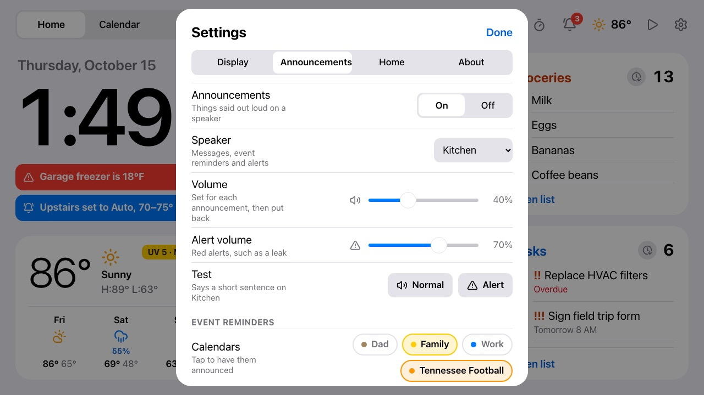

# Announcements: what the frame says out loud

**Needs:** Home Assistant on the frame and a speaker in it that can talk (a `media_player`: an
Echo, a Nest speaker, anything with text-to-speech). The `script.frame_announce` below is optional but better. Without HA, Settings has
no speaker to pick and nothing is said.

**Settings → Announcements** (off until you turn it on) sets what the frame says out loud, on one
speaker from Home Assistant (an Echo, a Nest speaker, anything with text-to-speech): the speaker, an
announcement volume and a louder **alert volume** for red alerts, a **Test** for each, **event
reminders**, and whether agent messages are read aloud. Nothing is said at night (Settings →
Display → Night). Timer alerts keep their own speaker on the same page.

## How it speaks

The frame speaks through a Home Assistant script,
[`homeassistant/scripts/frame-announce.yaml`](../homeassistant/scripts/frame-announce.yaml) (add it
as `script.frame_announce`): an Echo's Announce when the speaker has one, otherwise text-to-speech,
at the announcement volume, putting the speaker's own volume back afterwards. Other automations can
use it too. Without the script the frame falls back to plain text-to-speech at the speaker's
current volume. Everything said is in the frame's event log (`announce`, with what was said and on
which speaker, and `announce.skipped` with why).

## Event reminders

Tap a calendar to have its events announced ("In 30 minutes: Swim lesson, at the Aquatic center"),
all off to start. An event is said at each of its own reminders between 0 and 2 hours before (15
and 5 minutes before, say), otherwise once at the lead time chosen (30 minutes by default). Its own
reminders are the iCal `VALARM`s in its feed: Fastmail and Google secret addresses include them, but
iCloud's public links never do and Outlook's usually don't. For an Apple calendar, send it through
the Mac bridge to get them ([calendar.md](calendar.md#apple-calendars-through-the-mac)). If the
frame was off at the first reminder, it says only the latest one due, not two back to back. All-day events aren't said. An event's details show when it
will be announced. The frame does the timing, so nothing is said while it's off; a reminder missed
by up to 10 minutes (a reload) is still said if the event hasn't started. **Own reminders** decides
whether an event's own reminders win over the lead time.

## Home alerts

A red notice (a leak, the freezer; see [notices.md](notices.md)) is said when it appears, "Alert:
Water under the kitchen sink", at the alert volume and at night too (or kept quiet at night), once
or every 10 minutes until it clears or is dismissed. Orange notices can be said too, at the normal
volume and never at night; blue ones never are. The notices sheet marks the ones said as
"Announced".

## Agent messages and timers

**Agent messages** (see [messages.md](messages.md)) are read aloud when that switch is on: "Message
from <from>. <title>. <body>", up to 400 characters, never at night and never twice. **Timer
alerts** announce a finished timer on their own speaker (see [timers.md](timers.md)).
