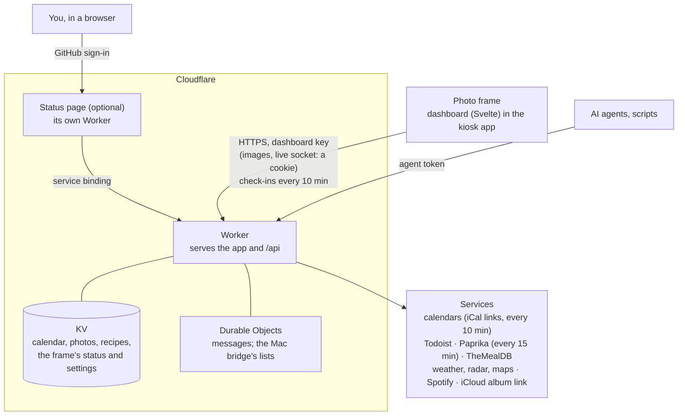
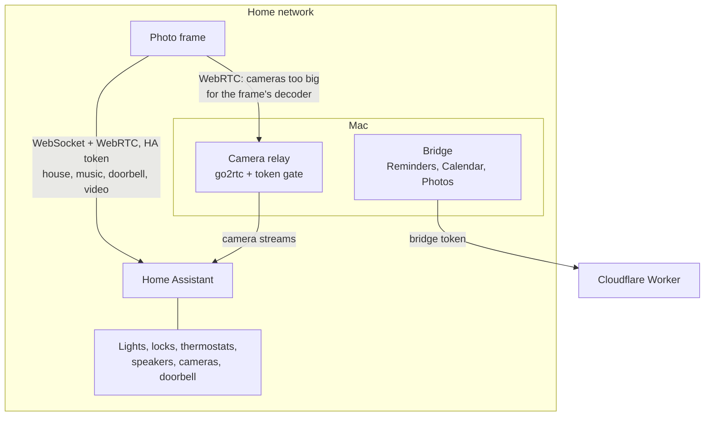

# Architecture

How the parts fit, in two halves: the frame and the Worker on the internet, and what's on the home
network. Each part's own README says what it is and when you need it
([README → Layout](../README.md#layout)).

## The frame, the Worker and the services

- **The frame** holds only the dashboard key (and, with Home Assistant, that token). It never
  talks to Todoist, Paprika, iCloud or calendar servers itself.
- **The Worker** holds every other credential as Cloudflare secrets and caches what it fetches in
  KV. Scheduled jobs refresh calendars every 10 minutes and sync Paprika every 15. The Durable
  Objects hold the live connections: messages to the frame, and the Mac bridge's lists with the
  frame's changes queued for it.
- **The status page** (optional, `dashboard/ops/`) is a second Worker behind GitHub sign-in, for one
  allowed account. It reads the main Worker's summary over a service binding, so it holds no keys
  to the services: the frame's check-ins and event log, and how calendars, lists, Paprika and the
  Mac bridge are doing ([frame.md](frame.md#status-page-optional)).
- **Secrets** go from `dashboard/.dev.vars` (gitignored) to Cloudflare with
  `dashboard/scripts/push-secrets.sh`; the frame's own settings go to it once with
  `dashboard/scripts/frame-url.sh`. What each opens: [SECURITY.md](../SECURITY.md).

## At home

Everything here is optional. Home Assistant gives the house; the Mac adds what a server can't reach.

- **Home Assistant** is reached directly on the home network, never through Cloudflare, with a
  non-admin user that can only log in locally. Camera and doorbell video comes over WebRTC, set up
  through that same connection.
- **The Mac bridge** reads Apple Reminders, iCloud calendars and a shared album as you and sends
  them to the Worker; the frame never talks to it ([mac-bridge.md](mac-bridge.md)).
- **The camera relay** shrinks cameras the frame can't decode and serves them to the frame
  directly; its API only listens on the Mac, behind a token gate
  ([house.md](house.md#cameras-the-frame-cant-decode-the-camera-relay)).
