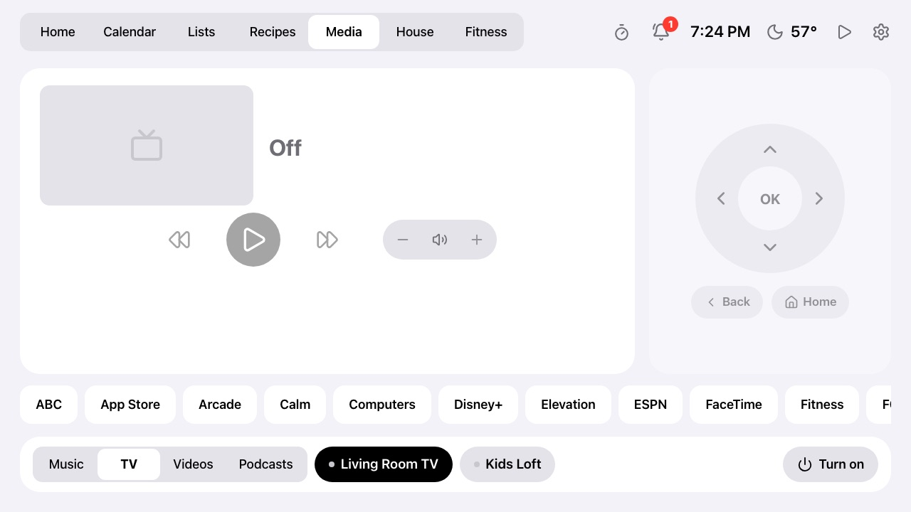

# Music

The **Music** tab plays Spotify on the house's speakers (Echos, Nest speakers, a computer: anything
Spotify Connect can reach), controlled through Home Assistant. This page covers how it works and how
to set it up. There are three parts; only the first is required. Without Home Assistant on the
frame there's no Media tab; without HA's Spotify integration it controls your other HA media
players, without Spotify's playlists and speaker switching (the TV view doesn't need Spotify).

| Part | What it gives you | Needs |
| --- | --- | --- |
| [1. HA's Spotify integration](#1-home-assistants-spotify-integration) | The player: song, cover, play/pause, skip, volume, speakers, playlists (the first 48) | Spotify Premium, a Spotify developer app, Home Assistant |
| [2. Starting from silence on an Echo](#2-starting-from-silence-on-an-echo) | Play when nothing has played for a while | HA's Alexa Devices integration |
| [3. The Worker's Spotify connection](#3-every-playlist-and-whats-playing-the-workers-spotify-connection) | Every playlist, sorted by what was really played last, and which playlist is playing | The same developer app, a one-time sign-in |

## What you see

- **Music tab:** cover, song, artist, album and the playlist it's playing from; a progress bar;
  previous, play/pause and next; volume; a row of playlists (**Recent** or **A–Z**; swipe it, or use
  a mouse wheel on a computer); and the speakers along the bottom. Tap a speaker to move what's
  playing there; tap a playlist to play it on the chosen speaker.
- **Home:** a Now Playing card between the clock and the weather: a row on the frame, a big cover
  on a taller screen. Notices come first; when two of them fill the column, the card steps aside.
- **Other tabs:** a small cover and play/pause in the top bar. Tap the cover for the Music tab.
- **Controls answer at once.** Spotify takes a few seconds to confirm a change, so the frame shows
  what you asked for straight away (the play button pulses until Spotify catches up) and the volume
  slider stays where you left it instead of jumping through the in-between values.
- Something paused within the last 30 minutes stays on screen, so it can be resumed.

## 1. Home Assistant's Spotify integration

The frame talks to Home Assistant directly on the home network (see
[house.md](house.md#setup) for the HA URL and token). HA's
[Spotify integration](https://www.home-assistant.io/integrations/spotify/) provides the player;
playback control needs **Spotify Premium**.

1. **Create a Spotify developer app** at [developer.spotify.com/dashboard](https://developer.spotify.com/dashboard),
   signed in with your Spotify account → **Create app**:
   - **Name:** Home Assistant (anything). **Description:** anything.
   - **Redirect URIs:** add `https://my.home-assistant.io/redirect/oauth`. If you'll set up
     [part 3](#3-every-playlist-and-whats-playing-the-workers-spotify-connection), also add
     `http://127.0.0.1:8888/callback` now (exactly, with `127.0.0.1`, not `localhost`).
   - **APIs used:** Web API. Accept the terms and **Save**. (When editing later, **Save** at the
     bottom of Settings is what stores a new redirect URI.)
2. In the app's **Settings**, copy the **Client ID** and, under **View client secret**, the secret.
3. **In Home Assistant:** Settings → Devices & services → **Add integration** → **Spotify**. Give it
   the client ID and secret as *application credentials*, then sign in to Spotify and agree.

The Spotify player (`media_player.spotify_<you>`) appears in HA, and the Music tab uses it
automatically. Its **speakers** are your Spotify Connect devices:

- An Echo or Nest speaker appears once it has played Spotify at least once. If one is missing, play
  something on it ("Alexa, play … on Spotify") and give HA a few minutes.
- Names come from Spotify, which takes them from the device when it's first linked. A speaker renamed
  in the Alexa app may keep its old name in Spotify for a while; restarting it and playing Spotify
  on it usually catches up, and unlinking and relinking Spotify in the Alexa app always does.
- Devices Spotify lists only by an ID are left out.

Without HA's Spotify integration, the tab falls back to Home Assistant's own media players (Music
Assistant speakers, say), each controlled separately, without the playlist row.

## 2. Starting from silence on an Echo

HA's Spotify player can only control a session that's already going; after a while of nothing
playing it can't start one. For that, the frame asks the chosen Echo as if spoken ("play Spotify",
"play Workout playlist on Spotify") through HA's
[Alexa Devices](https://www.home-assistant.io/integrations/alexa_devices/) integration. Add that
integration in HA (Settings → Devices & services → Add integration → Alexa Devices, signing in with
your Amazon account), and set Spotify as the default music service in the Alexa app. Once Spotify is
playing, the frame's controls take over as usual.

## 3. Every playlist and what's playing: the Worker's Spotify connection

HA's Spotify integration lists only the **first 48** playlists, only **while something is playing**,
and can't say **which playlist** is playing or was played last. With this optional connection, the
Worker reads those from Spotify itself:

- every playlist in your library, the ones you made and the ones you follow;
- **Recent** sorted by when each was last played on any device (Spotify keeps your last 50 songs and
  where each was played from; the frame adds what it has seen itself);
- what's playing from, under the artist: a playlist ("From …", with its card outlined), an album,
  an artist, Liked Songs, or "Not from a playlist" (a song started on its own, or autoplay);
- **Up next**: the next songs in Spotify's queue, between the song and the controls when there's room
  (a big window; on the frame's 1280×720 the controls fill the card);
- the cover's main colour, washed across the Now Playing card.

Playing still goes through Home Assistant. The Worker asks for read-only access: your playlists,
recently played, currently playing and playback state (for the queue). A sign-in made before Up next
existed lacks that last one: run the sign-in script again (step 3) and push the new token.

**Setup** (about five minutes, once). The same developer app as part 1 works:

1. In the app's Settings at developer.spotify.com, make sure `http://127.0.0.1:8888/callback` is a
   redirect URI (and click **Save**).
2. Put its client ID and secret in `dashboard/.dev.vars`:

   ```sh
   SPOTIFY_CLIENT_ID="…"
   SPOTIFY_CLIENT_SECRET="…"
   SPOTIFY_REFRESH_TOKEN=""
   ```

3. From `dashboard/`, run the sign-in script. It opens Spotify's permission page in your browser;
   click **Agree**, and it saves `SPOTIFY_REFRESH_TOKEN` in `.dev.vars` without printing it.

   ```sh
   node scripts/spotify-auth.mjs
   ```

4. Send the three settings to the Worker:

   ```sh
   scripts/push-secrets.sh SPOTIFY_CLIENT_ID SPOTIFY_CLIENT_SECRET SPOTIFY_REFRESH_TOKEN
   ```

Reload the frame's page and the playlist row shows them all. If a later version of the frame asks
for a new permission, run steps 3 and 4 again.

**If something's off:**

- *"redirect_uri: Not matching configuration"* from Spotify: the callback address isn't saved in the
  app's Settings (step 1), or isn't exactly `http://127.0.0.1:8888/callback`.
- *The port is in use:* an earlier run is still waiting; `pkill -f spotify-auth.mjs` and run it again.
- Without these settings, or if Spotify is unreachable, the tab uses HA's list (the first 48) and the
  frame's own record of what it saw played.

## Notes

- Spotify's own apps aren't involved: Spotify's lyrics, for instance, aren't available to other apps.
- Requests: the playlist list is fetched when the Music tab opens and every five minutes while it
  shows; "what's playing" once per song. Both are small.

## The Media tab and TV

The **Media** tab has **Music | TV** at the bottom when Home Assistant has a TV.

**Music** is Spotify on the house's speakers, through Home Assistant: song, controls, volume,
playlists and speakers, with a Now Playing card on Home and a small one in every other tab's top
bar. Controls show the change at once instead of waiting seconds for Spotify to confirm, and a
tapped playlist shows in the player straight away ("Starting on Kitchen…") until Spotify reports it
playing; the frame also asks Home Assistant to check Spotify right after a tap rather than at its
next 30-second poll. With nothing playing, the volume slider sets the chosen speaker's own volume.

**TV** is any TV Home Assistant knows, found by its integration (Apple TV, Android TV, Roku, LG
webOS, Samsung, Sony Bravia, Vizio, Philips, Panasonic, DirecTV) or a `tv` device class: what's
playing in any app (title, episode, artwork, progress), play/pause and 10 s back and forward, the
TV's apps (the ones watched lately first; one tap opens one), power, and an on-screen remote
(arrows, OK, back, home) when the TV has a `remote` entity on the same device and its integration
is Apple TV, Android TV Remote or Roku. A TV playing shows in Now Playing too; **Settings → Home →
Now Playing → Music only** leaves TVs out.



**Volume behind a soundbar.** Volume steps and mute go to the TV, or to the speaker that plays its
sound when `TV_AUDIO` in `.frame.vars` names one (`media_player.tv=media_player.soundbar`,
comma-separated for several TVs). That's needed behind a soundbar: an Apple TV can't read the
soundbar's level, so Home Assistant takes it as 0 and volume down does nothing, while a soundbar
with its own integration (Alexa built in, Sonos) steps both ways and shows its level. A **Soundbar |
TV speakers** switch under the controls sends volume back to the TV on nights its own speakers are
on. Nothing about the household's TVs is in the code.

## Videos: YouTube for the kids

**Needs:** only the `YOUTUBE_VIDEOS` setting; no Home Assistant, no YouTube account. Without it
there's no Videos view (and without Home Assistant either, no Media tab at all).

Media → **Videos** shows chosen YouTube videos and playlists as rows of big thumbnails, a group per
row ("Blippi", "Diggers"), each with its length, for kids to pick from. A tap plays it nearly full
screen in YouTube's own embedded player, with sound, and goes on to the next in the group when it
ends. Under the video is our own bar: big volume **−** and **+** with a level (remembered on the
frame), pause, next, and **Close**; YouTube's own volume slider is small and hides while playing.
The volume tops out at the frame's Android media volume.

Each group has a sort button beside its name: **most recently played** on this frame first (the
default; the rest in playlist order), or **A–Z**, remembered per group. **Find a video** in the
bottom bar narrows every group to titles with all the words typed.

Set in `dashboard/.dev.vars`, then `scripts/push-secrets.sh` (a secret, since what a household watches
is its own business): groups separated by `|`, each a name, a colon and links to videos or
playlists, in any mix:

```
YOUTUBE_VIDEOS="Blippi: https://www.youtube.com/playlist?list=PL… | Diggers: https://youtu.be/… https://youtu.be/…"
```

- **Playlists** must be public or unlisted (an unlisted playlist in your own account is the usual
  choice). Without a key the Worker reads YouTube's public feed, which has a playlist's **15 newest**
  videos; with `YOUTUBE_API_KEY` (free from Google Cloud: a project, the YouTube Data API v3
  enabled, an API key) it reads whole playlists.
- **Single videos** need no key: their titles come from YouTube's oEmbed, and lengths from each
  video's page (kept, a few dozen looked up per refresh), or from the API with a key.
- The list is kept for 6 hours; `GET /api/youtube?refresh` fetches it again at once.
- A video whose channel doesn't allow playing outside YouTube is skipped when it comes up.

**On this frame:** YouTube sends VP9, which the FRAME156's RK3326 decodes on its CPU, not in hardware.
A full-size player made YouTube choose 720p, then 480p, and stalled 6 times a minute; the player is
therefore laid out at 640×360 and scaled up, so YouTube sends less, and it plays smoothly (captions
work). Sound comes from the frame's own speaker: this frame has no Bluetooth radio to send it to a
speaker. YouTube's player script loads when Videos opens, so a tap starts the video in about a second.

### Sharing a video from a phone

From YouTube on an iPhone: **Share → Play on Kitchen Frame**, and the frame plays it at once, over
whatever it's showing (the clock screen too), in the same player. It starts muted with a big **Tap
for sound**: the frame's browser plays sound only after a touch, and a shared video comes without
one. Works from anywhere; only a phone with the Shortcut (and its token) can send.

**Needs:** `SHARE_TOKEN` on the Worker: any long random string (`openssl rand -hex 24`), in
`dashboard/.dev.vars`, then `scripts/push-secrets.sh`. It opens `POST /api/share/play` and nothing
else, so a leaked one can only play a video on the frame. Not the agent token.

**The Shortcut,** once per phone, in the Shortcuts app:

1. **+** → name it **Play on Kitchen Frame**. In its details (the **i**), turn on **Show in Share
   Sheet**, and set what it receives to **URLs** (and **Text**: some apps share a link as text).
2. Add **Get Contents of URL**:
   - URL: `https://<your worker>/api/share/play`
   - Method: **POST**
   - Headers: `Authorization` = `Bearer ` followed by the `SHARE_TOKEN`
   - Request Body: **JSON**, one field: `url` (Text) = **Shortcut Input**
3. Add **Get Dictionary Value**: `title` from the previous step's contents, then **Show
   Notification** with it ("Playing …"), so you know it reached the frame. If the frame isn't
   connected, or the video can't be played outside YouTube, the reply's `error` says so instead.

The Worker accepts a link in any form (youtu.be, watch, Shorts), with or without tracking
parameters, as JSON (`url`) or plain text.
