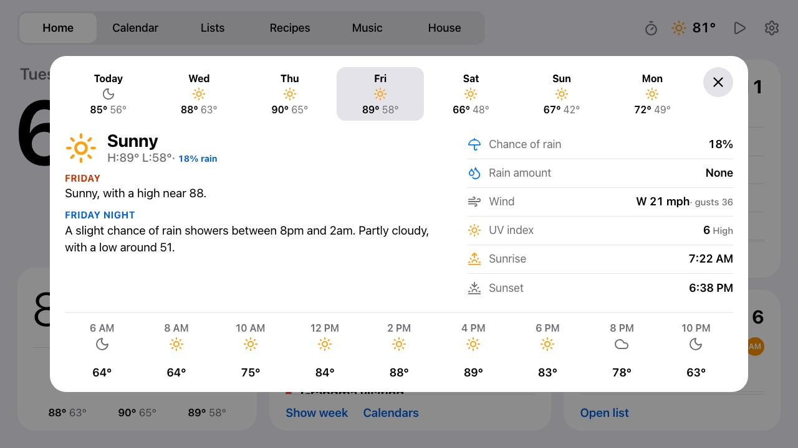

# Weather

Home shows the temperature, conditions, the UV right now (for sunscreen; hidden when it's under 1)
and a three-day forecast; the top bar shows the temperature on every tab. Tap the weather for a
day's sheet: the National Weather Service's written forecast (US), the hours ahead, chance and
amount of rain, wind, the day's peak UV, and sun times. Tap another day along the top to switch. The
theme follows the same feed's sunrise and sunset.

## Alerts

While the Weather Service has alerts out for home, an **Alerts** button sits beside Radar, in the
colour of the worst one (the furthest day makes room for it). Today shows a single line for them all,
and Home's card the worst one with "+2 more". The alerts view lists them worst first (warnings, then
watches, advisories and statements), two of the same kind merged into one, each with a short summary;
tap one for its text tidied into sections (What, Where, Impacts, Places…), the Weather Service's
advice under **What to do**, and "includes Ames" when the home town is named. Product codes, the
"has issued a" preamble, the end time repeated, links and map coordinates are left out.

The summaries come from Workers AI (`worker/wx-alert-ai.js`, the same Gemma model as the meal
groceries): one line for the list and a couple of sentences to say, written once per alert and kept
in KV until it ends. When the model is slow, over its daily allowance or answers badly, the frame uses
the alert's own first sentence instead. Cancel notices aren't shown.

## Setup

**Needs:** just your location; no accounts or keys. Without it Home says "Weather isn't set up yet." The written
forecast, alerts and part of the radar are US-only (National Weather Service); elsewhere those parts
are left out.

Set `WEATHER_LAT` and `WEATHER_LON` (plus `WEATHER_UNIT="celsius"` if you want it) as secrets
(`npx wrangler secret put`, as this deployment does) or `vars` in `dashboard/wrangler.jsonc`, and in
`.dev.vars` locally. [Open-Meteo](https://open-meteo.com) needs no key. In the US the same location
also brings the National Weather Service's written forecast and alerts (no key either); elsewhere the
detail sheet just leaves them out. The Worker fetches weather every 15 minutes and caches it, so the
frame never talks to the weather services itself.

## Radar

**Radar**, first in the day row of that sheet, loops the last hour, now and the next two hours of
rain around the same location, about the town and its neighbors (roughly 130 km across) over a
street map: Google's with `GOOGLE_MAPS_KEY` ([calendar.md](calendar.md#google-maps-platform)),
OpenStreetMap's otherwise. In the US the past and present frames are NWS radar and the forecast
frames are NOAA's HRRR model, both through the
[Iowa Environmental Mesonet](https://mesonet.agron.iastate.edu); elsewhere it's
[RainViewer](https://www.rainviewer.com)'s past two hours. All free, no key. Nothing loads until the
radar is opened; it starts on Now, forecast frames are marked in blue (and smoothed: HRRR's 3 km
cells would otherwise show as blocks), and dragging along the
timeline picks a time. Each frame is drawn once onto a small canvas, so the frame's slow Wi-Fi and
CPU see one set of tiles per frame rather than a pile of images.
